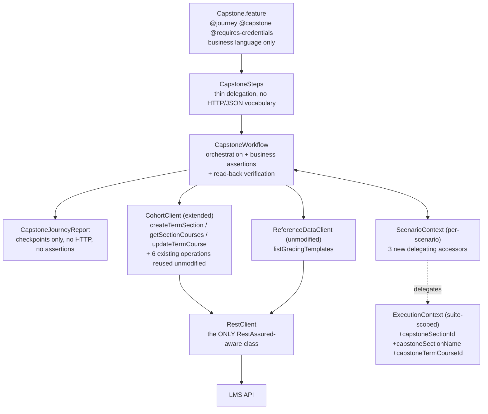

# Design Document

## Overview

Capstone Mini-Setup adds ONE Cucumber scenario to the existing Java / RestAssured / Cucumber LMS API test
framework. It runs in `features/10_journeys/`, after `00_setup/EnvironmentSetup.feature` (`@environment-setup`)
has provisioned and authenticated the suite-scoped runtime environment, and before `99_cleanup/Cleanup.feature`
(`@cleanup`) tears it down. It consumes the SAME runtime Cohort, Program Term, CourseMaster and Student that
Environment Setup created, and it provisions exactly two new things: one Capstone Outclass Section and one
SectionCourse mapping inside that section.

The stage is deliberately small in surface area and deliberately explicit about entity identity. Four things
in this feature all read like "the course" - CourseMaster, TermCourse, the SectionCourse mapping, and the
Section itself - and the whole design is shaped around never confusing them. Requirement 5 exists purely
because the capstone TermCourse is a DIFFERENT entity from the normal TermCourse that the Assignment,
Session and Attendance journeys depend on, even though both wrap the same CourseMaster.

### What the design adds

| Layer | Change | New/Extended |
| --- | --- | --- |
| Feature | `features/10_journeys/Capstone.feature` | New |
| Steps | `steps/workflows/CapstoneSteps.java` | New |
| Orchestration | `workflows/CapstoneWorkflow.java` | New |
| Reporting | `reporting/CapstoneJourneyReport.java` | New |
| HTTP | `clients/admin/CohortClient.java` (+3 methods) | Extended |
| Suite state | `context/ExecutionContext.java` (+3 fields) | Extended |
| Scenario state | `context/ScenarioContext.java` (+3 delegating accessors) | Extended |

### What the design deliberately does NOT touch

`BootstrapWorkflow`, `BootstrapSteps`, `CourseClient`, `ReferenceDataClient`, `RestClient`, `CleanupManager`,
`CleanupSummary`, `CreatedResource`, `ResourceType`, `EnvironmentSetup.feature`, `Cleanup.feature`, every other
journey / steps / workflow / report class, `RunCucumberTest`, `pom.xml`, `DateUtils`.

Two of those are worth calling out because a naive implementation WOULD touch them:

- `ReferenceDataClient.listGradingTemplates` already exists and is used unmodified. The capstone stage resolves
  `templateMasterId` at journey runtime through it, because `ScenarioContext`'s attribute bag (where
  `BootstrapSteps` parks `gradingTemplateId`) is per-scenario and therefore empty in this scenario
  (Requirements 4.3, 4.4). No grading-template field is added to `ExecutionContext` (Requirements 4.5, 8.5).
- `CleanupManager` handles COHORT and PROGRAM only; every other registered type is a logged skip. The capstone
  resources are registered for registry symmetry and are skipped by that existing behaviour, so no delete
  endpoint is introduced (Requirement 10).

`RunCucumberTest` needs no change: it selects the whole `features` classpath resource and globs glue from
`com.lms.steps`, so a new feature under `10_journeys/` and a new steps class under `steps/workflows/` are
discovered automatically. Execution order relative to the other journeys is irrelevant - the capstone stage
depends only on Environment Setup, and resolves everything else itself.

## Architecture

### Layering

The stage adds no new layer. It slots into the framework's existing four-layer split, and the single rule that
makes that split hold - RestAssured types appear only inside `RestClient` (Requirement 9.6) - is preserved
because all three new operations are `CohortClient` methods that delegate to `RestClient`.



### Reused vs new HTTP operations

| Operation | Endpoint | Status |
| --- | --- | --- |
| `createTermSection` | `POST /api/v1/program/{cohortId}/termSection` | NEW (Requirement 9.1) |
| `getSectionCourses` | `GET /api/v1/program/section/{sectionId}/sectionCourses` | NEW (Requirement 9.2) |
| `updateTermCourse` | `PATCH /api/v1/program/termCourse/{termCourseId}` | NEW (Requirement 9.3) |
| `getSectionStudents` | `GET .../programTerm/{ptId}/section/{sectionId}/getSectionStudents` | reused unmodified |
| `getUnassignedUsers` | `GET .../{cohortId}/term/{ptId}/getUnassignedUser?sectionId=` | reused unmodified |
| `enrollStudents` | `POST .../programTerm/{ptId}/section/{sectionId}/enrollStudents` | reused unmodified |
| `attachCourseToSection` | `POST .../programTerm/{ptId}/sectionCourse` | reused unmodified |
| `getTermCourseDetail` | `GET /api/v1/program/termCourse/{termCourseId}` | reused unmodified |
| `getSectionDetail` | `GET .../programTerm/{ptId}/section/{sectionId}` | available, not used by this stage |
| `listGradingTemplates` | `GET /api/v1/organization/{orgId}/getAllGradingTemplates` | reused unmodified |

`createSection` (`POST .../programTerm/{programTermId}/section`) stays exactly as it is: it is a different
endpoint with a different path shape from `createTermSection`, so the new method is an addition, never a
rename or a widening of the old one (Requirement 9.4).

### Sequence

```mermaid
sequenceDiagram
    autonumber
    participant ST as CapstoneSteps
    participant WF as CapstoneWorkflow
    participant CC as CohortClient
    participant RD as ReferenceDataClient
    participant API as LMS API
    participant EC as ExecutionContext

    ST->>WF: requireRuntimeEnvironmentReady()
    WF->>EC: requireEnvironmentReady() + read cohortId/programTermId/courseId/studentUuid/adminUserId/adminOrgId/adminToken

    ST->>WF: createCapstoneOutclassSection()
    WF->>CC: createTermSection(cohortId, {programTermId, isCapstoneSection:true}, adminUserId)
    CC->>API: POST /program/{cohortId}/termSection
    API-->>CC: 201 {Data:{uuid, name, isCapstoneSection}}
    WF->>EC: capstoneSectionId, capstoneSectionName; register SECTION

    ST->>WF: assignRuntimeStudentToCapstoneSection()
    WF->>CC: getSectionStudents(programTermId, capstoneSectionId)
    CC->>API: GET .../getSectionStudents
    WF->>CC: getUnassignedUsers(cohortId, programTermId, capstoneSectionId)
    CC->>API: GET .../getUnassignedUser
    WF->>CC: enrollStudents(programTermId, capstoneSectionId, {studentIds:[{id}]}, adminUserId)
    CC->>API: POST .../enrollStudents

    ST->>WF: addRuntimeCourseToCapstoneSection()
    WF->>RD: listGradingTemplates(adminOrgId)
    RD->>API: GET .../getAllGradingTemplates
    WF->>CC: attachCourseToSection(programTermId, {sectionArray, courseArray, templateMasterId}, adminUserId)
    CC->>API: POST .../programTerm/{ptId}/sectionCourse

    ST->>WF: verifyRuntimeStudentInCapstoneSection()
    WF->>CC: getSectionStudents(programTermId, capstoneSectionId)
    CC->>API: GET .../getSectionStudents
    API-->>CC: 200 roster
    Note over WF: roster must contain studentUuid

    ST->>WF: verifyRuntimeCourseInCapstoneSection()
    WF->>CC: getSectionCourses(capstoneSectionId)
    CC->>API: GET /program/section/{capstoneSectionId}/sectionCourses
    API-->>CC: 200 {Data:[{uuid, CourseMaster:{uuid}, Section:{uuid}, isGamify}], Count}
    WF->>EC: capstoneTermCourseId; register SECTION_COURSE

    ST->>WF: enableCapstoneCourseGamification()
    WF->>CC: getTermCourseDetail(capstoneTermCourseId)
    CC->>API: GET /program/termCourse/{capstoneTermCourseId}
    API-->>CC: 200 {Data:{termCourse:{...}, taIds, facultyIds}}
    Note over WF: build the 31-key edit body, isGamify false -> true
    WF->>CC: updateTermCourse(capstoneTermCourseId, body, adminUserId)
    CC->>API: PATCH /program/termCourse/{capstoneTermCourseId}

    ST->>WF: verifyCapstoneCourseGamified()
    WF->>CC: getTermCourseDetail(capstoneTermCourseId)
    CC->>API: GET /program/termCourse/{capstoneTermCourseId}
    Note over WF: read 1 - isGamify true, Section/CourseMaster/ProgramTerm chain
    WF->>CC: getSectionCourses(capstoneSectionId)
    CC->>API: GET /program/section/{capstoneSectionId}/sectionCourses
    Note over WF: read 2 - isGamify true on the CourseMaster-matched entry
```

Two design points visible in that sequence:

1. `capstoneTermCourseId` is resolved exactly once, in `verifyRuntimeCourseInCapstoneSection`, and reused by
   both later steps (Requirement 7.2). Nothing re-derives it.
2. The gamification PATCH is preceded by a full read of the TermCourse, because the endpoint expects a complete
   course-edit object rather than a single changed field (Requirements 6.1, 6.4).

## Components and Interfaces

### 1. `Capstone.feature` (new) - `src/test/resources/features/10_journeys/Capstone.feature`

One scenario, one Given precondition plus the seven business steps, in the order Requirement 1.7 fixes. Step
text carries no HTTP method, URL, status code, JSON field name, uuid or RestAssured term (Requirements 12.1, 12.2).

```gherkin
  @journey @capstone @requires-credentials
  Scenario: Admin sets up a capstone section on the runtime environment
    Given the runtime environment is ready for the capstone journey
    When the admin creates a Capstone Outclass section
    And the runtime student is assigned to the Capstone section
    And the existing runtime course is added to the Capstone section
    Then the Capstone section contains the runtime student
    And the Capstone section contains the runtime course
    When the admin enables gamification for the Capstone course
    Then the Capstone course is verified as gamified
```

Tag strings confirmed against the feature files (this closes Known Uncertainty 3): `00_setup/EnvironmentSetup.feature`
carries `@environment-setup @cross-functional @requires-credentials`, `99_cleanup/Cleanup.feature` carries
`@cleanup @lifecycle`, and the existing journeys carry `@journey @<journey-name> @requires-credentials` - which
is the pattern `@journey @capstone @requires-credentials` follows. The runner selects the whole `features`
resource with no tag filter, so ordering comes from directory naming (`00_` → `10_` → `99_`), not from tags.

The feature file also carries the usual header comment block (Feature narrative + a BUSINESS JOURNEY note
naming the four distinct entities from the Glossary), matching `SessionJourney.feature`'s house style.

### 2. `CapstoneSteps` (new) - `steps/workflows/CapstoneSteps.java`

Constructor-injected `ScenarioContext` (PicoContainer), one `CapstoneWorkflow` instance, one method per step,
each body a single delegation (Requirements 12.3, 12.4).

```java
public class CapstoneSteps {
    private final ScenarioContext context;
    private final CapstoneWorkflow capstoneWorkflow;

    public CapstoneSteps(ScenarioContext context) { ... }

    @Given("the runtime environment is ready for the capstone journey")   // -> requireRuntimeEnvironmentReady
    @When("the admin creates a Capstone Outclass section")                // -> createCapstoneOutclassSection
    @When("the runtime student is assigned to the Capstone section")      // -> assignRuntimeStudentToCapstoneSection
    @When("the existing runtime course is added to the Capstone section") // -> addRuntimeCourseToCapstoneSection
    @Then("the Capstone section contains the runtime student")            // -> verifyRuntimeStudentInCapstoneSection
    @Then("the Capstone section contains the runtime course")             // -> verifyRuntimeCourseInCapstoneSection
    @When("the admin enables gamification for the Capstone course")       // -> enableCapstoneCourseGamification
    @Then("the Capstone course is verified as gamified")                  // -> verifyCapstoneCourseGamified
}
```

Design decision - the Given step delegates too. `AttendanceJourneySteps` performs its readiness guard inline
in the steps class. This stage puts it in the workflow instead (`requireRuntimeEnvironmentReady`), because
Requirements 1.2 and 1.3 name `Capstone_Workflow` as the component that asserts readiness and Requirement 12.3
requires every assertion to be delegated. That makes eight workflow methods: the seven named business methods
plus this precondition guard.

### 3. `CapstoneWorkflow` (new) - `workflows/CapstoneWorkflow.java`

Owns orchestration, business assertions and read-back verification (Requirement 12.5). Holds a `CohortClient`
and a `ReferenceDataClient`; holds no per-scenario mutable state beyond method locals (ids live in
`ExecutionContext`), so nothing can leak between scenarios.

```java
public class CapstoneWorkflow {
    private static final Logger log = LoggerFactory.getLogger(CapstoneWorkflow.class);

    private final CohortClient cohortClient;
    private final ReferenceDataClient referenceDataClient;

    // --- one public method per Gherkin step ---
    public void requireRuntimeEnvironmentReady(ScenarioContext context);
    public void createCapstoneOutclassSection(ScenarioContext context);
    public void assignRuntimeStudentToCapstoneSection(ScenarioContext context);
    public void addRuntimeCourseToCapstoneSection(ScenarioContext context);
    public void verifyRuntimeStudentInCapstoneSection(ScenarioContext context);
    public void verifyRuntimeCourseInCapstoneSection(ScenarioContext context);
    public void enableCapstoneCourseGamification(ScenarioContext context);
    public void verifyCapstoneCourseGamified(ScenarioContext context);

    // --- private helpers ---
    private Map<String, Object> buildTermCourseUpdatePayload(Map<String, Object> termCourse,
                                                             Object taIds, Object facultyIds);
    private Map<String, Object> findSectionCourseByCourseMaster(Response sectionCourses, String courseId);
}
```

**`requireRuntimeEnvironmentReady`** - calls `context.execution().requireEnvironmentReady()` (whose existing
message already names `EnvironmentSetup.feature` as the missing prerequisite, satisfying Requirement 1.3), then
asserts `cohortId`, `programTermId`, `courseId`, `studentUuid`, `sectionId`, `termCourseId`, `adminUserId`,
`adminOrgId` and `adminToken` are all non-blank (Requirement 1.4). It makes NO request and does NOT require
`isActiveTerm` to be true (Requirement 1.6) - no term-state read happens anywhere in the stage.

**`createCapstoneOutclassSection`** - builds `{programTermId: <ExecutionContext programTermId>,
isCapstoneSection: true}`, calls `createTermSection` (which stamps `createdBy`), asserts status == 201
(Requirement 2.4), asserts `Data.isCapstoneSection` is true (Requirement 2.5), captures `Data.uuid` and
`Data.name` (Requirement 2.6), asserts the captured id is non-blank with the body in the message
(Requirement 2.7) and differs from `ExecutionContext.sectionId` (Requirement 2.8). It asserts nothing about
`Data.programTermId` / `Data.programId` / `Data.createdBy`, which are numeric internal identifiers in a
different id space from the uuids this framework carries - Requirement 2.10 makes that omission explicit
rather than accidental. The section name is taken from the response and never composed locally
(Requirement 2.9), which also means the stage sends no generated name string. Registers `capstoneSectionId`
under `ResourceType.SECTION`, then records the "Capstone Outclass Section Created" checkpoint.

**`assignRuntimeStudentToCapstoneSection`** - replays the admin UI's own three-call order through the existing,
unmodified operations (Requirement 3.2):

1. `getSectionStudents(programTermId, capstoneSectionId)` - pre-state read; status asserted 2xx only. No
   assertion is made about the pre-enrollment roster contents beyond that; the post-enrollment assertion in
   `verifyRuntimeStudentInCapstoneSection` is what proves the enrollment.
2. `getUnassignedUsers(cohortId, programTermId, capstoneSectionId)` - locates the runtime student in
   `Data.Program.UserPrograms[].User` by uuid and asserts they are present.
3. `enrollStudents(programTermId, capstoneSectionId, {studentIds:[{id: studentUuid}]}, adminUserId)` - the
   client stamps `createdBy`, producing exactly the body Requirement 3.3 specifies. Status asserted 2xx.

Design decision - the "genuinely unassigned" guard is deliberately weakened here, and this is why
`BootstrapWorkflow.enrollStudentInSection` cannot be reused wholesale. That method asserts the student's
`UserSections` is EMPTY, which is true only for a brand-new student. By the time this stage runs, the runtime
student is already enrolled in the Normal Section, so `UserSections` is non-empty by design. This stage
therefore asserts the weaker, correct condition: the student appears in the Program's member list, and no
`UserSections` entry has a `Section.uuid` equal to `capstoneSectionId` (i.e. not already in the capstone
section). Reusing the Bootstrap guard verbatim would fail on a correct environment.

No student is created (Requirement 3.6) and the Normal Section roster is never written to - the only
enrollment call in the stage targets `capstoneSectionId` (Requirement 3.7).

**`addRuntimeCourseToCapstoneSection`** - resolves `templateMasterId` at journey runtime by calling
`listGradingTemplates(adminOrgId, adminToken)` and extracting a uuid via `JsonSearch.findFirstValue(body, "uuid")`,
the same helper `BootstrapSteps` uses; a null result fails the scenario with a message stating no grading
template is available (Requirements 4.3, 4.7). The attach body mirrors the HAR-verified shape
`BootstrapWorkflow` sends, with the capstone section id substituted:

```
sectionArray: [ { sectionId: capstoneSectionId } ]
courseArray:  [ { courseMasterId: courseId, courseTypeId, courseTagId, courseModeId,
                  courseClassId, subjectWeight: "", isSubjectWeightEnable: false } ]
templateMasterId: <resolved at runtime>
```

`courseTypeId`, `courseTagId`, `courseModeId` and `courseClassId` (`ExecutionContext.classTypeId`) come from
`ExecutionContext`, set by Environment Setup. `attachCourseToSection` stamps `createdBy` and is not modified
(Requirement 4.2). Status asserted 2xx. No CourseMaster is created (Requirement 4.8), `BootstrapSteps` is
untouched (Requirement 4.6), and nothing grading-template shaped is written to `ExecutionContext`
(Requirements 4.5, 8.5).

**`verifyRuntimeStudentInCapstoneSection`** - reads the capstone roster with `getSectionStudents` and asserts
an entry whose student uuid equals `studentUuid` exists (Requirement 3.4). On failure the message reports how
many roster entries were found (Requirement 3.5). Records "Runtime Student Added to Capstone Section".

**`verifyRuntimeCourseInCapstoneSection`** - the read-back that both confirms the attachment and resolves the
capstone TermCourse (Requirement 5). Calls `getSectionCourses(capstoneSectionId)`, asserts 2xx, then uses
`findSectionCourseByCourseMaster` to select the `Data[]` entry whose `CourseMaster.uuid` equals `courseId`,
matching on uuid only and never on course name (Requirements 5.2, 5.3). From that entry it captures `uuid` as
`capstoneTermCourseId` (Requirement 5.4) and asserts `Section.uuid` equals `capstoneSectionId`
(Requirement 5.5) and that `capstoneTermCourseId` differs from `ExecutionContext.termCourseId`
(Requirement 5.6). Registers the mapping under `ResourceType.SECTION_COURSE` and records "Runtime Course Added
to Capstone Section".

Design decision - this does NOT call `BootstrapWorkflow.verifyCourseAttached`, and does not use
`getSectionDetail` either. `verifyCourseAttached` writes the mapping uuid it finds into
`ScenarioContext.sectionCourseId`, which delegates to the suite-scoped `ExecutionContext` and would overwrite
the normal section's mapping id that Environment Setup stored (Requirement 5.9). This stage leaves
`sectionCourseId` untouched (Requirement 5.8), which is only possible with its own resolution path.

**`enableCapstoneCourseGamification`** - reads `getTermCourseDetail(capstoneTermCourseId)` first
(Requirement 6.1), asserts 2xx, then builds the complete 31-key edit body through
`buildTermCourseUpdatePayload` (Requirements 6.2, 6.4, 6.5) and sends it via `updateTermCourse`, which stamps
`updatedBy`. Status asserted 2xx (Requirement 6.8). The only target is `capstoneTermCourseId`; no request in
this stage is addressed to `ExecutionContext.termCourseId` (Requirement 6.9). No checkpoint is recorded here -
the 2xx alone is not evidence (Requirements 6.10, 13.7), so the "Capstone Course Gamification Enabled"
checkpoint belongs to the verification step.

**`verifyCapstoneCourseGamified`** - two independent reads (Requirement 7):

- Read 1, `getTermCourseDetail(capstoneTermCourseId)` (Requirements 7.1, 7.2): asserts
  `Data.termCourse.isGamify` is true (7.3), `Data.termCourse.Section.uuid` equals `capstoneSectionId` (7.4),
  `Data.termCourse.CourseMaster.uuid` equals `courseId` (7.5) and `Data.termCourse.ProgramTerm.uuid` equals
  `programTermId` (7.6). It additionally asserts `Data.termCourse.Section.isCapstoneSection` is true - the
  field is present in the verified evidence and it re-confirms, from a different endpoint, that gamification
  landed on a capstone section rather than on a section that merely happens to be new.
- Read 2, `getSectionCourses(capstoneSectionId)` (Requirement 7.7): re-matches the entry by
  `CourseMaster.uuid` through the same private helper and asserts `isGamify` is true on it (7.8).

Each assertion message names WHICH read produced the disagreement ("termCourse detail read" vs
"section-courses projection"), satisfying Requirement 7.9. On success it records "Capstone Course Gamification
Enabled", then "Capstone Mini-Setup Complete", then publishes the report.

**`buildTermCourseUpdatePayload`** - the private payload builder. Takes the `Data.termCourse` map plus the
TOP-LEVEL `Data.taIds` / `Data.facultyIds` and returns a `LinkedHashMap` with the 31 keys in the verified
order. Full mapping in Data Models below. It performs the transforms and nothing else - it makes no request,
reads no context and holds no state, which is what makes it the one genuinely unit-testable piece of the stage.

**`findSectionCourseByCourseMaster`** - the private lookup helper. Takes a `sectionCourses` response and the
CourseMaster uuid, returns the matching `Data[]` entry, and throws with the list of `CourseMaster.uuid` values
actually present when there is no match (Requirement 5.7). Used by both Requirement 5's resolution and
Requirement 7.8's confirmation, so the two can never drift into matching by different criteria.

### 4. `CohortClient` (extended) - three added methods

Request shaping only; no assertion, no orchestration, no business logic (Requirement 9.7). Every call goes
through `RestClient` (Requirements 9.5, 9.6). Each method mirrors an existing sibling exactly.

```java
/** POST /api/v1/program/{cohortId}/termSection - creates a section directly under a cohort's term.
 *  Distinct from createSection (POST .../programTerm/{ptId}/section) - different path, kept separate. */
public Response createTermSection(String cohortId, Map<String, Object> fields, String createdBy, String bearerToken) {
    Map<String, Object> payload = new HashMap<>(fields);
    payload.put("createdBy", createdBy);
    return restClient.post(programBase() + "/" + cohortId + "/termSection", payload, bearerToken);
}

/** GET /api/v1/program/section/{sectionId}/sectionCourses?searchParam=&pageSize=10&pageNo=1&toggle=
 *  - the section's course list. Pagination params are required, as with listProgramTerms. */
public Response getSectionCourses(String sectionId, String bearerToken) {
    Map<String, Object> queryParams = new HashMap<>();
    queryParams.put("searchParam", "");
    queryParams.put("pageSize", "10");
    queryParams.put("pageNo", "1");
    queryParams.put("toggle", "");
    return restClient.get(programBase() + "/section/" + sectionId + "/sectionCourses", queryParams, bearerToken);
}

/** PATCH /api/v1/program/termCourse/{termCourseId} - full course-edit object; stamps updatedBy,
 *  exactly as updateProgramTerm does. Caller supplies every other field verbatim. */
public Response updateTermCourse(String termCourseId, Map<String, Object> fields, String updatedBy, String bearerToken) {
    Map<String, Object> payload = new HashMap<>(fields);
    payload.put("updatedBy", updatedBy);
    return restClient.patch(programBase() + "/termCourse/" + termCourseId, payload, bearerToken);
}
```

Note `createTermSection`'s `fields` is supplied by the workflow as `{programTermId, isCapstoneSection:true}`
only, so the wire body is exactly the three fields Requirement 2.3 names once `createdBy` is stamped.
`getSectionCourses` uses the same query-params-map overload `getSectionStudents` and `listProgramTerms` use,
with string values, mirroring `getSectionStudents`'s convention.

### 5. `ExecutionContext` (extended) - exactly three fields

```java
/**
 * Capstone Mini-Setup outputs. capstoneSectionId/Name are the NEW capstone Section (never the
 * Environment Setup sectionId); capstoneTermCourseId is the runtime CourseMaster's instance inside
 * THAT section - a different entity from termCourseId, which the Assignment/Session/Attendance
 * journeys depend on. Resolved once per stage, from response payloads captured in the current run.
 */
private String capstoneSectionId;
private String capstoneSectionName;
private String capstoneTermCourseId;
// + standard getters/setters, placed in a "Capstone journey outputs" block
```

Nothing else is added (Requirement 8.1), in particular no grading-template field (Requirement 8.5). The
existing `sectionId` and `termCourseId` fields are read but never written by this stage
(Requirements 8.3, 8.4), which is enforced structurally: `CapstoneWorkflow` calls no setter for either, and
avoids the one existing method that would (`verifyCourseAttached`).

### 6. `ScenarioContext` (extended) - three delegating accessors

```java
// ================= Capstone journey (delegated -> ExecutionContext) =================
public String getCapstoneSectionId()                       { return execution().getCapstoneSectionId(); }
public void   setCapstoneSectionId(String v)               { execution().setCapstoneSectionId(v); }
public String getCapstoneSectionName()                     { return execution().getCapstoneSectionName(); }
public void   setCapstoneSectionName(String v)             { execution().setCapstoneSectionName(v); }
public String getCapstoneTermCourseId()                    { return execution().getCapstoneTermCourseId(); }
public void   setCapstoneTermCourseId(String v)            { execution().setCapstoneTermCourseId(v); }
```

Pure delegation, matching every other entity accessor in the class (Requirement 8.2).

### 7. `CapstoneJourneyReport` (new) - `reporting/CapstoneJourneyReport.java`

A near-copy of `AttendanceJourneyReport`: private constructor, `BANNER`/`CHECK` constants, a static
`checkpoint(ScenarioContext, String label, String... details)` that appends to
`context.appendEnvironmentSetupReportLine(...)`, and a static `publish(ScenarioContext)` that formats the
accumulated lines under a `CAPSTONE MINI-SETUP` heading and attaches them to `context.getCucumberScenario()`
(no-op when the handle is null). It performs no HTTP call and no assertion (Requirements 11.1, 11.7).

The five checkpoints, each recorded only after its assertions have already passed (Requirements 11.2-11.4):

| Checkpoint | Recorded in | Detail lines (no secrets) |
| --- | --- | --- |
| Capstone Outclass Section Created | `createCapstoneOutclassSection` | capstone section name, capstone section id, "distinct from the runtime section" |
| Runtime Student Added to Capstone Section | `verifyRuntimeStudentInCapstoneSection` | student uuid, "verified via section roster read-back" |
| Runtime Course Added to Capstone Section | `verifyRuntimeCourseInCapstoneSection` | course name, capstone termCourse id, "matched by CourseMaster uuid" |
| Capstone Course Gamification Enabled | `verifyCapstoneCourseGamified` | "confirmed by termCourse read", "confirmed by section-courses read" |
| Capstone Mini-Setup Complete | `verifyCapstoneCourseGamified` | 1 section + 1 section-course created; no program/cohort/term/course/student created |

Tokens, refresh tokens, passwords and `Authorization` values appear in no report line and in no
`CapstoneWorkflow` log statement (Requirements 11.5, 11.6). The workflow's `log.info` banners follow the
existing house style but print only names and ids - the same discipline `BootstrapWorkflow` and
`AttendanceWorkflow` already keep.

## Data Models

### Create Capstone Section

Request `POST /api/v1/program/{cohortId}/termSection`:

```json
{ "programTermId": "<ExecutionContext.programTermId>", "isCapstoneSection": true, "createdBy": "<adminUserId>" }
```

Response 201, fields this stage reads:

| Path | Use |
| --- | --- |
| `Data.uuid` | captured as `capstoneSectionId` |
| `Data.name` | captured as `capstoneSectionName` (backend-generated, never composed locally) |
| `Data.isCapstoneSection` | asserted true |

`Data.programTermId`, `Data.programId` and `Data.createdBy` are numeric internal identifiers, unusable for
uuid assertions, and deliberately unasserted (Requirement 2.10).

### Section courses (the SectionCourse mapping projection)

`GET /api/v1/program/section/{sectionId}/sectionCourses?searchParam=&pageSize=10&pageNo=1&toggle=`, 200:

| Path | Use |
| --- | --- |
| `Data[].uuid` | the TermCourse id - captured as `capstoneTermCourseId` on the matched entry |
| `Data[].CourseMaster.uuid` | the match key against `ExecutionContext.courseId` |
| `Data[].Section.uuid` | asserted equal to `capstoneSectionId` |
| `Data[].isGamify` | asserted true in the second verification read |
| `Count` | reported in failure messages |

This projection carries NO `CourseMode` and NO `NpsDepartment`, so it cannot build the gamification PATCH
body - which is exactly why the update path reads the TermCourse detail endpoint first.

### TermCourse detail

`GET /api/v1/program/termCourse/{termCourseId}`, 200. Scalars live under `Data.termCourse.*`; associations are
nested objects; `taIds` and `facultyIds` are TOP-LEVEL under `Data`.

| Path | Use |
| --- | --- |
| `Data.termCourse.*` (scalars) | source of the carried-through PATCH fields |
| `Data.termCourse.CourseMode.uuid` | → `courseModeId` |
| `Data.termCourse.CourseType.uuid` | → `courseTypeId` |
| `Data.termCourse.CourseTag.uuid` | → `courseTagId` |
| `Data.termCourse.CourseClass.uuid` | → `courseClassId` |
| `Data.termCourse.NpsDepartment.uuid` | → `departmentId` |
| `Data.termCourse.Section.uuid` | asserted equal to `capstoneSectionId` |
| `Data.termCourse.Section.isCapstoneSection` | asserted true |
| `Data.termCourse.CourseMaster.uuid` | asserted equal to `courseId` |
| `Data.termCourse.ProgramTerm.uuid` | asserted equal to `programTermId` |
| `Data.termCourse.ProgramTerm.Program.uuid` | the COHORT id (this nested "Program" is the cohort, not the Program Master) |
| `Data.termCourse.isGamify` | false before the update, asserted true after |
| `Data.taIds` (TOP-LEVEL) | → `taIds` |
| `Data.facultyIds` (TOP-LEVEL) | → `facultyIds` |

### Gamification PATCH body - the 31 keys, in order

`PATCH /api/v1/program/termCourse/{capstoneTermCourseId}`. Built by `buildTermCourseUpdatePayload` into a
`LinkedHashMap` so the wire order matches the captured request. "Verbatim" means the value from
`Data.termCourse` is carried through with no transform.

| # | Key | Source | Transform |
| --- | --- | --- | --- |
| 1 | `credits` | `Data.termCourse.credits` | number → String |
| 2 | `courseModeId` | `Data.termCourse.CourseMode.uuid` | nested uuid |
| 3 | `courseTypeId` | `Data.termCourse.CourseType.uuid` | nested uuid |
| 4 | `courseTagId` | `Data.termCourse.CourseTag.uuid` | nested uuid |
| 5 | `courseClassId` | `Data.termCourse.CourseClass.uuid` | nested uuid |
| 6 | `hours` | `Data.termCourse.hours` | verbatim |
| 7 | `isAttendanceCalculated` | `Data.termCourse.isAttendanceCalculated` | verbatim |
| 8 | `departmentId` | `Data.termCourse.NpsDepartment.uuid` | nested uuid, NOT the numeric `departmentId` |
| 9 | `evaluationCriteria` | `Data.termCourse.evaluationCriteria` | verbatim |
| 10 | `courseOverview` | `Data.termCourse.courseOverview` | verbatim |
| 11 | `description` | `Data.termCourse.description` | verbatim |
| 12 | `courseOutcome` | `Data.termCourse.courseOutcome` | verbatim |
| 13 | `workexperienced` | `Data.termCourse.workexperienced` | verbatim (spelling preserved) |
| 14 | `readingMaterial` | `Data.termCourse.readingMaterial` | verbatim |
| 15 | `videoLink` | `Data.termCourse.videoLink` | verbatim |
| 16 | `topicsJson` | `Data.termCourse.topicsJson` | verbatim |
| 17 | `courseDomain` | — | always an empty array |
| 18 | `placementCourse` | `Data.termCourse.placementCourse` | verbatim |
| 19 | `subjectWeight` | `Data.termCourse.subjectWeight` | null → `""` |
| 20 | `showCourseToStudent` | `Data.termCourse.showCourseToStudent` | verbatim |
| 21 | `isCourseCalculated` | `Data.termCourse.isCourseCalculated` | verbatim |
| 22 | `taIds` | `Data.taIds` (TOP-LEVEL) | verbatim |
| 23 | `facultyIds` | `Data.facultyIds` (TOP-LEVEL) | verbatim |
| 24 | `isGamify` | — | always `true` (the sole value mutation) |
| 25 | `isGamifyDomainWise` | `Data.termCourse.isGamifyDomainWise` | verbatim |
| 26 | `attendanceType` | `Data.termCourse.attendanceType` | verbatim |
| 27 | `coursePurpose` | `Data.termCourse.coursePurpose` | verbatim |
| 28 | `isCreditCalculated` | `Data.termCourse.isCreditCalculated` | verbatim |
| 29 | `isGpaCalculated` | `Data.termCourse.isGpaCalculated` | verbatim |
| 30 | `noOfSession` | `Data.termCourse.noOfSession` | verbatim |
| 31 | `updatedBy` | `adminUserId` | injected by `CohortClient.updateTermCourse`, mirroring `updateProgramTerm` |

Why `departmentId` must come from `NpsDepartment.uuid`: the read response's flat `departmentId` is a numeric
internal id in a different identifier space from the uuid the update expects. Sending the numeric value would
either be rejected or bind the course to the wrong department - a silent, hard-to-spot data corruption
(Requirement 6.5).

INFERENCE (the single one in this design) - `courseDomain` versus `TermCourseDomains`. The captured evidence
shows a domain-related field under two names across the read and update contracts, empty in every captured
payload. This design sends `courseDomain: []` on update (Requirement 6.6) and sends no `TermCourseDomains`
key at all. That is an inference, not verified evidence: whether the backend also accepts or expects
`TermCourseDomains` on update, and what a non-empty value looks like, is unknown. It is safe for this stage
because the runtime course has no domains, so an empty array is a faithful no-change value. This is Known
Uncertainty 1 from the requirements, and it is confirmable only by a capture of a domain-carrying course edit.

### The 16 read-response fields deliberately omitted from the PATCH

`isMandatory`, `isCourseReview`, `isDraft`, `displayOrder`, `startDate`, `endDate`, `sectionId`,
`sessionFormat`, `status`, `remarks`, `moderatedDiscussion`, `transactionId`, `isSubjectWeightEnable`,
`AttendanceStats`, `feedbackSummary`, `isAttendaceStatsProcessed` (Requirement 6.7; the misspelling of the
last one is the API's own and is preserved when reading).

Separately read-only and also not sent: `uuid`, `createdBy`, `createdAt`, `updatedAt`, and every nested
association object (`CourseMode`, `CourseType`, `CourseTag`, `CourseClass`, `NpsDepartment`, `Section`,
`CourseMaster`, `ProgramTerm`) - the update carries their `*Id` uuid equivalents instead.

### Context state written by this stage

| Field | Value | Source |
| --- | --- | --- |
| `capstoneSectionId` | new capstone Section uuid | create response `Data.uuid` |
| `capstoneSectionName` | new capstone Section name | create response `Data.name` |
| `capstoneTermCourseId` | capstone TermCourse uuid | section-courses `Data[].uuid` on the CourseMaster match |

Nothing else in `ExecutionContext` is written. `sectionId`, `termCourseId` and `sectionCourseId` are read-only
here (Requirements 5.8, 8.3, 8.4). Every value stored is captured from a response received during the current
run (Requirements 8.6, 13.1), and no literal uuid or date string appears anywhere in the stage's source
(Requirements 13.2, 13.3) - the create body carries no name and no dates, and the PATCH carries dates only as
values the same run just read back (`startDate`/`endDate` are among the 16 omitted fields, so in fact no date
crosses the wire from this stage at all).

## Error Handling

The stage has no recovery paths: every failure is a scenario failure. What the design specifies is the
QUALITY of the failure, because these assertions run against a live environment where the reader has no
debugger and only the report to work from.

Four rules, all consistent with the existing workflows:

1. **AssertJ with `.as(...)` on every assertion.** No bare `assertThat(x).isTrue()`. The description names the
   business entity and, for HTTP status assertions, appends the response body:
   `.as("capstone section creation must succeed. Response: " + response.getBody().asString())`.
2. **Precondition failures name the missing stage, not the missing field.** The readiness guard delegates to
   `ExecutionContext.requireEnvironmentReady()`, whose existing `IllegalStateException` already names
   `EnvironmentSetup.feature` as the prerequisite and tells the operator to run the full suite
   (Requirement 1.3). Individual id guards then add which id is blank.
3. **Lookup failures print the candidate set, not just "not found".** A reader who sees "no match" learns
   nothing; a reader who sees the uuids that WERE present learns immediately whether the attach silently
   no-oped, whether they are looking at the wrong section, or whether the match key is wrong.
4. **Nothing sensitive in any message.** Response bodies from these endpoints carry no credentials; tokens are
   never interpolated into messages or logs (Requirements 11.5, 11.6).

Assertion-message catalogue:

| Condition | Requirement | Message content |
| --- | --- | --- |
| Environment not ready | 1.3 | names Environment Setup as the missing prerequisite (existing guard message) |
| Create section status != 201 | 2.4 | expected 201, actual status, full response body |
| `Data.isCapstoneSection` not true | 2.5 | "created section must report isCapstoneSection" + body |
| `capstoneSectionId` blank | 2.7 | "capstone section id must be present in the create response" + full body |
| `capstoneSectionId` == `sectionId` | 2.8 | both ids, stating the capstone section must be a NEW section, not the runtime section |
| Student missing from capstone roster | 3.5 | student uuid + the number of roster entries found |
| Student absent from Program member list | 3.2 | student uuid, "must be a member of the runtime Program before enrollment" |
| No grading template uuid | 4.7 | "no grading template is available for the runtime organization - seed at least one" |
| No `Data[]` entry matches `courseId` | 5.7 | the expected CourseMaster uuid + every `CourseMaster.uuid` present, and `Count` |
| Matched entry's `Section.uuid` != `capstoneSectionId` | 5.5 | both ids, naming the section-courses read |
| `capstoneTermCourseId` == `termCourseId` | 5.6 | both ids, stating the capstone TermCourse must be a distinct instance from the normal one |
| PATCH status outside 200-299 | 6.8 | actual status + full response body |
| `isGamify` not true in read 1 | 7.3, 7.9 | "termCourse detail read reports isGamify=<actual>" |
| `isGamify` not true in read 2 | 7.8, 7.9 | "section-courses projection reports isGamify=<actual>" |
| Relation chain mismatch | 7.4-7.6 | which relation (Section / CourseMaster / ProgramTerm), expected vs actual uuid |

Requirement 7.9 is satisfied by rule 3 plus the two distinct wordings above: the message itself states which
of the two reads disagreed, so the reader never has to guess whether the write failed or only one projection
is stale.

## Cleanup Registration

The registry is append-only and suite-scoped; `Cleanup.feature` walks it in REVERSE at the end of the run.
This stage appends two entries, in creation order, after everything Environment Setup registered
(Requirement 10.6):

| Order | Type | Id | Registered in | Requirement |
| --- | --- | --- | --- | --- |
| 1 | `ResourceType.SECTION` | `capstoneSectionId` | `createCapstoneOutclassSection`, after the create assertions pass | 10.1 |
| 2 | `ResourceType.SECTION_COURSE` | the matched mapping entry's `uuid` (= `capstoneTermCourseId`) | `verifyRuntimeCourseInCapstoneSection`, after the mapping is verified | 10.2 |

The SECTION_COURSE entry is registered through the existing
`registerCreated(ResourceType, String, Map<String,String>)` overload with a deletion context of
`{"sectionId": capstoneSectionId, "courseMasterId": courseId}`, mirroring how the Attendance journey carries
forward what a future delete handler would need. That is metadata only - no deletion behaviour is defined.

`CleanupManager` is not modified (Requirement 10.3). It deletes COHORT and PROGRAM and records a logged skip
for every other type, so both capstone entries become skips with no new code
(Requirement 10.4), and no delete endpoint for sections, section-course mappings or term courses is introduced
(Requirement 10.5). No enrollment entry is registered: the requirements name exactly two registrations, and
inventing a third would put an unverifiable id class into the registry.

Known Uncertainty 2 stays open by design: whether deleting the runtime Cohort cascades to the capstone
Section, its enrollment, its mapping and its TermCourse is unverified, and because `CleanupManager` skips both
capstone types, the stage asserts nothing about cascade behaviour in either direction.

## Testing Strategy

The deliverable here IS a test, so "testing strategy" means two things: how the stage verifies the SYSTEM, and
how the stage itself is verified.

### How the stage verifies the system: read-back, never status

Every state change is confirmed by a separate read whose payload is asserted (Requirements 13.6, 13.7). A 2xx
is treated as "the request was accepted", never as "the change happened":

| State change | Read-back that proves it |
| --- | --- |
| Capstone section created | the create response payload itself carries `uuid`/`name`/`isCapstoneSection`, all asserted; the section is then re-proven by every later read that resolves `Section.uuid` back to it |
| Student enrolled | `getSectionStudents` on the capstone section, student uuid matched in the roster |
| Course attached | `getSectionCourses` on the capstone section, entry matched by `CourseMaster.uuid` |
| Gamification enabled | TWO independent reads: `getTermCourseDetail` and `getSectionCourses` |

Gamification is the only change verified twice, because it is the only change whose write is a full-object
overwrite: a 31-key PATCH that silently drops or mistypes a field can persist `isGamify` while corrupting
something else, and a single projection can be stale. Two endpoints disagreeing is itself diagnostic
information (Requirement 7.9).

### How the stage itself is verified

- **Compile + architecture.** `mvn -q test-compile`, and the existing `StudentCredentialIsolationTest`
  architecture test stays green. Requirement 9.6 (RestAssured confined to `RestClient`) holds by construction:
  the only `io.restassured` import the new code needs is `Response` in `CohortClient` and `CapstoneWorkflow`,
  matching every existing client and workflow.
- **Journey execution.** The stage is exercised by running the full suite (`mvn test`), which executes
  `00_setup` → `10_journeys` → `99_cleanup` in that order. It cannot be validated in isolation: the readiness
  guard fails fast without Environment Setup, which is the intended behaviour.
- **Regression check on the untouched paths.** After this stage runs, the Assignment, Session and Attendance
  journeys must still pass on the same suite run. That is the real assurance that `sectionId`,
  `termCourseId` and `sectionCourseId` were left intact - which is why `verifyRuntimeCourseInCapstoneSection`
  avoids `verifyCourseAttached` rather than working around its side effect afterwards. The stage makes no
  assertion of its own about the normal TermCourse's `isGamify`; Requirement 6.9 is satisfied structurally
  (no request in the stage is addressed to `termCourseId`), and adding an unrequested read of the normal
  course would put this stage in the business of verifying an entity it does not own.
- **Unit test opportunity.** `buildTermCourseUpdatePayload` is the one pure function in the stage: a
  `Data.termCourse` map plus `taIds`/`facultyIds` in, a 31-key `LinkedHashMap` out. It is worth a small
  example-based unit test (fixture map in → assert the exact key set, the key order, `credits` as a String,
  `subjectWeight` `null` → `""`, `departmentId` from the nested uuid, `courseDomain` `[]`, `isGamify` `true`,
  and that none of the 16 omitted keys is present). No HTTP, no context, no live environment needed.

### Why property-based testing does not apply here

Assessed and deliberately omitted, so no Correctness Properties section appears in this design.

This stage is a single fixed integration scenario against a live external service. There is no meaningful
"for all inputs X" statement available: the inputs are one cohort, one program term, one course master and one
student, all fixed by Environment Setup, and every step is I/O against the LMS API. Behaviour does not vary
with generated input - it varies with server state - and 100 iterations would mean creating 100 capstone
sections on a shared environment, which is both expensive and a side effect the requirements explicitly rule
out (Requirement 13.4: exactly one Section).

The one genuinely pure component, `buildTermCourseUpdatePayload`, has a fixed 31-key output contract rather
than a universal invariant; the interesting failures are "wrong key name", "wrong nesting", "wrong type",
which a single fixture-based test pins down exactly and generated inputs would not surface. Example-based
unit tests plus the read-back verification above are the right tools for this feature.

## Requirements Traceability

| Requirement | Design elements |
| --- | --- |
| 1. Journey stage placement and preconditions | `Capstone.feature` (one scenario, `@journey @capstone @requires-credentials`, 8 steps in the fixed order); `CapstoneWorkflow.requireRuntimeEnvironmentReady` (delegates to `ExecutionContext.requireEnvironmentReady`, then asserts the 9 required context values); no term-state read anywhere in the stage (1.6); placement under `features/10_journeys/`, discovered by the unmodified `RunCucumberTest` |
| 2. Create the Capstone Outclass Section | `CohortClient.createTermSection` (`POST /program/{cohortId}/termSection`, stamps `createdBy`, 3-field body); `CapstoneWorkflow.createCapstoneOutclassSection` (201 assertion, `Data.isCapstoneSection` true, captures `Data.uuid`/`Data.name`, blank-id failure includes the body, id != `sectionId`, name taken from the response, numeric `programTermId`/`programId` deliberately unasserted) |
| 3. Enroll the Runtime Student | `CapstoneWorkflow.assignRuntimeStudentToCapstoneSection` (reused `getSectionStudents` → `getUnassignedUsers` → `enrollStudents`, `{studentIds:[{id}],createdBy}` body); `verifyRuntimeStudentInCapstoneSection` (roster read-back, entry count in the failure message); the weakened "not already in the capstone section" guard replacing Bootstrap's empty-`UserSections` check; only `capstoneSectionId` is ever enrolled into |
| 4. Attach the Runtime CourseMaster | `CapstoneWorkflow.addRuntimeCourseToCapstoneSection` (runtime `ReferenceDataClient.listGradingTemplates` + `JsonSearch.findFirstValue`, reused `attachCourseToSection`, HAR-shaped `sectionArray`/`courseArray`/`templateMasterId` body); no grading-template field in `ExecutionContext`; `BootstrapSteps` untouched; explicit "no grading template available" failure |
| 5. Verify the attachment and resolve the Capstone TermCourse | `CohortClient.getSectionCourses`; `CapstoneWorkflow.verifyRuntimeCourseInCapstoneSection` + `findSectionCourseByCourseMaster` (match on `CourseMaster.uuid` only, capture `Data[].uuid`, assert `Section.uuid`, assert != `termCourseId`, failure lists the CourseMaster uuids present); `sectionCourseId` untouched; `verifyCourseAttached` deliberately not called |
| 6. Enable gamification on the Capstone TermCourse | `CapstoneWorkflow.enableCapstoneCourseGamification` (reused `getTermCourseDetail` read first) + `buildTermCourseUpdatePayload`; `CohortClient.updateTermCourse` (`PATCH /program/termCourse/{id}`, stamps `updatedBy`); the 31-key ordered field-mapping table; `courseDomain: []` with the `TermCourseDomains` inference noted; the 16 omitted fields enumerated; 2xx asserted but no checkpoint recorded here |
| 7. Verify gamification through two independent reads | `CapstoneWorkflow.verifyCapstoneCourseGamified` (read 1 `getTermCourseDetail`: `isGamify`, `Section.uuid`, `Section.isCapstoneSection`, `CourseMaster.uuid`, `ProgramTerm.uuid`; read 2 `getSectionCourses` via the same private matcher); `capstoneTermCourseId` resolved once and reused; per-read wording in the failure messages |
| 8. Suite-scoped context extensions | `ExecutionContext` +`capstoneSectionId` +`capstoneSectionName` +`capstoneTermCourseId` with Javadoc distinguishing them from `sectionId`/`termCourseId`; `ScenarioContext` +3 delegating accessor pairs; no setter call for `sectionId`/`termCourseId`; no grading-template field; all three values captured from current-run responses |
| 9. Client extensions | `CohortClient.createTermSection` / `getSectionCourses` / `updateTermCourse`, each mirroring an existing sibling; `createSection` kept unchanged as a separate endpoint; all three go through `RestClient`, which stays the only RestAssured-aware class; no assertion or orchestration in the client |
| 10. Cleanup registration | SECTION registration in `createCapstoneOutclassSection`, SECTION_COURSE registration (with `sectionId`/`courseMasterId` deletion context) in `verifyRuntimeCourseInCapstoneSection`, in that creation order; `CleanupManager` unmodified, so both become logged skips; no delete endpoint introduced; Known Uncertainty 2 left explicitly open |
| 11. Reporting | `CapstoneJourneyReport` (`checkpoint`/`publish`, modeled on `AttendanceJourneyReport`, no HTTP, no assertions); the five named checkpoints mapped to the workflow methods that record them, each after its assertions pass - including "Capstone Course Gamification Enabled" being recorded in the VERIFICATION step, not the update step; no tokens/credentials in report lines or workflow logs |
| 12. Business-oriented Gherkin and layering | `Capstone.feature`'s 8 business-language step lines (no HTTP verbs, URLs, status codes, JSON field names, uuids or RestAssured terms); `CapstoneSteps` as one-line delegations, including the Given; `CapstoneWorkflow` owning orchestration + business assertions; `CohortClient` owning request shaping |
| 13. Runtime data and isolation guarantees | Every id read from `ExecutionContext` or captured from a current-run response; no literal uuid and no literal date in the stage's source (the create body carries neither a name nor dates; `startDate`/`endDate` are among the 16 omitted PATCH fields); exactly one Section and one SectionCourse mapping created; no Program/Cohort/Program Term/Normal Section/CourseMaster/Student created; every state change confirmed by a read-back; 2xx never treated as proof |
