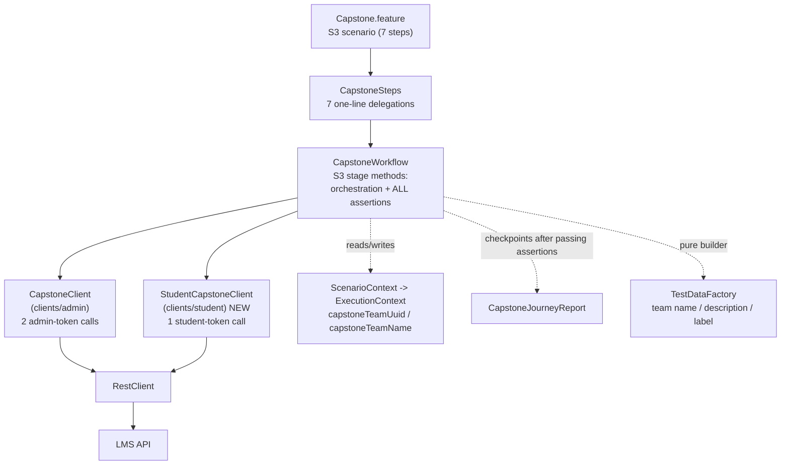
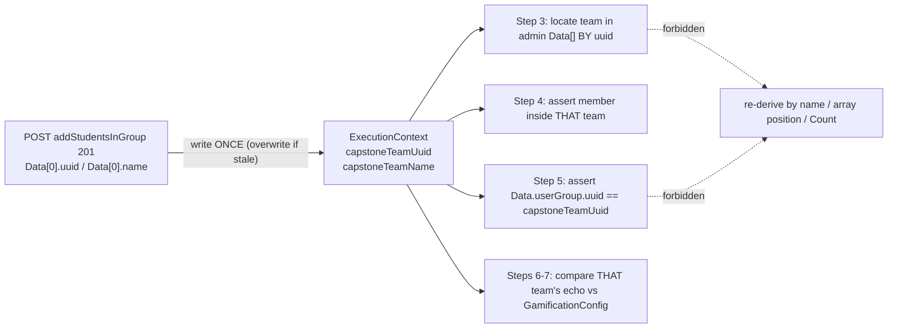

# Design Document

## Overview

S3 ("Admin creates a Capstone team and verifies the team configuration") is the **third scenario of the
existing Capstone business journey**, not a new journey. It consumes the suite-scoped state S1 and S2
already produced (capstone Section, capstone TermCourse, capstone GamificationConfig, runtime student,
admin session) and creates exactly ONE new entity: the Capstone team (`sectionGroup`).

The deliverable is automated test coverage: three HTTP calls, seven Gherkin steps, and a set of
assertions that prove the created team is visible with correct membership from BOTH the admin side and
the student side while carrying the Capstone gamification configuration S2 established.

| Fact | Value |
|------|-------|
| New entities created per run | 1 (the Capstone team) |
| HTTP calls in S3 | 3 (1 admin POST, 1 admin GET, 1 student GET) |
| New `.feature` files | **0** |
| New Java files | 1 (`StudentCapstoneClient`) |
| Cleanup registrations | 0 (documented decision, Requirement 10) |
| Blocking prerequisite | 3 missing `TestDataFactory.capstoneResource*` helpers (the project does not compile) |

Design themes, each traced to its requirement:

- **A 2xx is never evidence.** The create response is asserted but the persistence verdict is deferred
  to a fresh admin read (R2.8, R4.1).
- **Identity is resolved once.** `capstoneTeamUuid` is written at creation; every later step reads it and
  never re-derives the team from a name, an array position or `Count` (R3, R4.2).
- **Fresh authoritative reads only.** Every expected value comes from a read issued *during S3* or from
  `ExecutionContext`; S2's per-scenario attribute map is treated as empty at S3 start (R8).
- **The comparison surface is closed.** Exactly 9 field pairs are compared and exactly 6 fields are
  excluded with HAR-observed rationale carried next to each exclusion (R7).

---

## NON-NEGOTIABLE CONSTRAINT: ONE Capstone feature file

**This feature creates ZERO new `.feature` files.**

The S3 scenario is **appended to the existing file**:

```
src/test/resources/features/10_journeys/Capstone.feature
```

Specifically **forbidden**: creating, renaming, splitting or duplicating any Capstone Gherkin file.
`CapstoneTeamManagement.feature`, `capstone-team-management.feature`, `Team.feature`, `CapstoneTeam.feature`
or any other new/renamed `.feature` file is a defect, not an alternative.

The `.kiro/specs/capstone-team-management/` folder is an **organizational container for the
requirements/design documents only**. Its name does not imply, and must not produce, a matching feature
file.

### Target final structure

```
src/test/resources/features/10_journeys/Capstone.feature
  Feature: Capstone Mini-Setup
    ├── S1: Admin sets up a capstone section on the runtime environment      (unchanged)
    ├── S2: Admin configures the Capstone course                            (unchanged)
    └── S3: Admin creates a Capstone team and verifies the team configuration   <-- appended
```

### What must be preserved byte-for-byte (R9.5, R13.1)

- The `Feature: Capstone Mini-Setup` name and its four `As a / I want / So that` lines.
- The long `# BUSINESS JOURNEY` / `# FOUR DISTINCT ENTITIES` / `# ISOLATION` / `# THE COMPLETE JOURNEY`
  comment block.
- The S1 scenario, its title, its tags (`@journey @capstone @requires-credentials`) and its steps.
- The S2 introductory comment block, the S2 scenario, its title, its tags
  (`@journey @capstone @configuration @requires-credentials`) and its steps.
- The S1 → S2 ordering.

The only edits to this file are **additive and at the end**: one new comment block introducing S3
(following the exact convention the file already uses to introduce S2) plus the S3 scenario.

### The scenario to append (exact wording, exact tags — R13.2, R13.3)

```gherkin
@journey @capstone @team-management @requires-credentials
Scenario: Admin creates a Capstone team and verifies the team configuration
  Given the Capstone course is configured and ready for team formation
  When the admin creates a Capstone team with the runtime student
  Then the Capstone team should be created successfully
  And the admin should see the runtime student as a member of the Capstone team
  And the student should see the Capstone team with the runtime student as a member
  And the Capstone team should inherit the configured Capstone metrics
  And the Capstone team should retain the configured Capstone configuration
```

Tag consequences (R13.4, R13.5): `@capstone` selects S1 + S2 + S3; `@team-management` selects S3 alone;
`@configuration` continues to select S2 alone. The S3 comment block must state that S3 consumes the
suite-scoped state produced by S1 and S2 and creates only the team (R13.8).

---

## Architecture

### Layering (fixed — R12.1)



Discipline per layer:

- **Steps**: a single delegation each. Zero HTTP, zero payload construction, zero assertions (R12.2).
- **Workflow**: every request, every assertion, every checkpoint, the payload builder, the lookup helpers.
- **Clients**: request shaping and serialisation only. No assertions, no orchestration, no business
  logic (R12.5).
- **RestClient**: unchanged. S3 introduces no timeout override and no retry (R2.1, R5.1).

### Touched files

| # | File | Change | Requirements |
|---|------|--------|--------------|
| 1 | `src/test/resources/features/10_journeys/Capstone.feature` | **Append only**: S3 comment block + S3 scenario. Nothing existing edited. | R13.1–R13.3, R13.8, R9.5 |
| 2 | `steps/workflows/CapstoneSteps.java` | Add 7 thin step methods under a new `S3` banner comment. Existing S1/S2 methods untouched. | R12.1, R12.2 |
| 3 | `workflows/CapstoneWorkflow.java` | Add the 7 S3 stage methods, the pure payload builder, and private lookup/comparison helpers. Existing S1/S2 methods untouched. | R1–R8, R10.4, R12 |
| 4 | `clients/admin/CapstoneClient.java` | Add `addStudentsInGroup` (POST) and `getAllSectionGroups` (GET). | R12.3, R12.6 |
| 5 | `clients/student/StudentCapstoneClient.java` | **NEW**: the single student-token capstone read. | R12.4 |
| 6 | `context/ExecutionContext.java` + `context/ScenarioContext.java` | Add `capstoneTeamUuid` / `capstoneTeamName` field + getter/setter on `ExecutionContext`; delegating accessors on `ScenarioContext`. | R3.1, R3.4 |
| 7 | `utils/TestDataFactory.java` | **Restore** `capstoneResourceFolderName()`, `capstoneResourceName()`, `capstoneResourceLink()` (compilation blocker). **Add** `capstoneTeamName()`, `capstoneTeamDescription()`, `capstoneTeamRepresentativeLabel()`. | R11 |
| 8 | `workflows/CapstoneWorkflowPayloadTest.java` | Add a third `====`-delimited section pinning the S3 payload contract. | R14 |

Explicitly **unchanged**: `CleanupManager`, `ResourceType`, `RestClient`, `Hooks`, `TestConfig`,
`EnvironmentConfig`, `CapstoneJourneyReport`, and every Assignment / Session / Attendance feature, step,
workflow and client (R9.6, R9.7, R10.2).

---

## Components and Interfaces

### 1. `CapstoneSteps` — 7 delegations (R12.2)

```java
// ================= S3: creating and verifying the Capstone team =================

@Given("the Capstone course is configured and ready for team formation")
public void theCapstoneCourseIsConfiguredAndReadyForTeamFormation() {
    capstoneWorkflow.validateCapstoneReadyForTeamFormation(context);
}

@When("the admin creates a Capstone team with the runtime student")
public void theAdminCreatesACapstoneTeamWithTheRuntimeStudent() {
    capstoneWorkflow.createCapstoneTeamWithRuntimeStudent(context);
}

@Then("the Capstone team should be created successfully")            // -> verifyCapstoneTeamCreated
@Then("the admin should see the runtime student as a member of the Capstone team")
                                                                     // -> verifyAdminSeesRuntimeStudentInTeam
@Then("the student should see the Capstone team with the runtime student as a member")
                                                                     // -> verifyStudentSeesCapstoneTeamMembership
@Then("the Capstone team should inherit the configured Capstone metrics")
                                                                     // -> verifyCapstoneTeamInheritsMetrics
@Then("the Capstone team should retain the configured Capstone configuration")
                                                                     // -> verifyCapstoneTeamRetainsConfiguration
```

The existing constructor (`this.capstoneWorkflow = new CapstoneWorkflow();`) is reused as-is.

### 2. `CapstoneWorkflow` — the S3 stage methods

```java
public void validateCapstoneReadyForTeamFormation(ScenarioContext context);   // R1 - 0 HTTP
public void createCapstoneTeamWithRuntimeStudent(ScenarioContext context);    // R2, R3 - 1 POST
public void verifyCapstoneTeamCreated(ScenarioContext context);               // R4.1-R4.4 - 1 admin GET
public void verifyAdminSeesRuntimeStudentInTeam(ScenarioContext context);     // R4.5-R4.8 - 0 HTTP
public void verifyStudentSeesCapstoneTeamMembership(ScenarioContext context); // R5 - 1 student GET
public void verifyCapstoneTeamInheritsMetrics(ScenarioContext context);       // R6 - 0 HTTP
public void verifyCapstoneTeamRetainsConfiguration(ScenarioContext context);  // R7 - 0 HTTP + publish()

// Pure, package-private, LinkedHashMap - unit-testable without a live environment (R14.1)
static Map<String, Object> buildCapstoneTeamPayload(String capstoneSectionId,
                                                    String capstoneTermCourseId,
                                                    String adminUserId,
                                                    String teamName,
                                                    String teamDescription,
                                                    String studentUuid,
                                                    String representativeLabel);

// Private helpers - identity-based selection, mirroring findSectionCourseByCourseMaster
private Map<String, Object> findTeamByUuid(Response adminRead, String teamUuid);          // R4.2, R4.3
private List<Map<String, Object>> memberEntriesFor(Map<String, Object> team, String studentUuid); // R4.5, R5.5
private void assertMetricSetsEqual(List<Map<String,Object>> teamMetrics,
                                   List<Map<String,Object>> configMetrics);               // R6
private void assertRetainedConfiguration(Map<String,Object> team, Map<String,Object> config); // R7
```

Conventions inherited from S1/S2 and applied unchanged: ids read from `ScenarioContext` at the top of each
method; status asserted before any body field is read (R8.3); `CapstoneJourneyReport.checkpoint(...)` only
after an assertion has passed (R13.6); `CapstoneJourneyReport.publish(context)` exactly once, at the end
of the final step (R13.7); no token, password or `Authorization` value in any log line, report line or
assertion message.

### 3. `CapstoneClient` (`clients/admin`) — 2 added admin-token calls

```java
/** POST /api/v1/program/addStudentsInGroup -> 201. Serialised with the existing null-preserving
 *  GSON so the caller's LinkedHashMap key order reaches the wire unchanged (R12.6). */
public Response addStudentsInGroup(Map<String, Object> payload, String bearerToken) {
    return restClient.post(programBase() + "/addStudentsInGroup", GSON.toJson(payload), bearerToken);
}

/** GET /api/v1/program/termCourse/{termCourseId}/section/{sectionId}/getAllSectionGroups
 *  ?searchParam=&pageSize=10000&pageNo=1 -> 200. The pagination trio is HAR-proven and sent
 *  verbatim, matching the existing "pagination params are required, not optional" finding on the
 *  sibling /program reads. */
public Response getAllSectionGroups(String termCourseId, String sectionId, String bearerToken) {
    Map<String, Object> queryParams = new HashMap<>();
    queryParams.put("searchParam", "");
    queryParams.put("pageSize", 10000);
    queryParams.put("pageNo", 1);
    return restClient.get(programBase() + "/termCourse/" + termCourseId + "/section/" + sectionId
            + "/getAllSectionGroups", queryParams, bearerToken);
}
```

`getAllSectionGroups` takes the capstone TermCourse and capstone Section ids as ordinary String
parameters — the client never reads context, so it cannot address the runtime section by accident.

### 4. `StudentCapstoneClient` (`clients/student`) — NEW (R12.4)

Placed under `clients/student/` because `CapstoneClient` is admin-scoped; the package already exists
(`AcademicSummaryClient`) and this follows its shape exactly.

```java
public class StudentCapstoneClient {
    private final RestClient restClient = new RestClient();

    /** GET /api/v1/program/capstoneGamifications/term/{programTermId}
     *      ?courseId={capstoneTermCourseId}&sectionId={capstoneSectionId} -> 200.
     *  NOTE: courseId is keyed by TERMCOURSE uuid, not CourseMaster uuid - the API's parameter name
     *  disagrees with the identity it keys off, and passing the CourseMaster uuid is a defect (R5.2).
     *  The bearer token is supplied by the caller; no credential is sourced here. */
    public Response getCapstoneGamificationForTerm(String programTermId, String capstoneTermCourseId,
                                                   String capstoneSectionId, String studentToken) {
        Map<String, Object> queryParams = new HashMap<>();
        queryParams.put("courseId", capstoneTermCourseId);
        queryParams.put("sectionId", capstoneSectionId);
        return restClient.get(TestConfig.API_V1 + "/program/capstoneGamifications/term/" + programTermId,
                queryParams, studentToken);
    }
}
```

### 5. Context additions (R3.1, R3.4)

`ExecutionContext` (suite-scoped singleton), in the existing Capstone block:

```java
/** The Capstone team S3 created: Data[0].uuid / Data[0].name from POST addStudentsInGroup.
 *  Resolved ONCE at creation and read by every later S3 step - never re-derived from a list read,
 *  a name search or an array position. */
private String capstoneTeamUuid;
private String capstoneTeamName;
// + getters/setters matching the existing capstone accessor convention
```

`ScenarioContext` adds two delegating getter/setter pairs in its Capstone block. No other context field
is added, and `sectionId` / `termCourseId` / `sectionCourseId` keep having no setter call anywhere in the
S3 code path (R9.2, R9.3).

### 6. `TestDataFactory` (R11)

The three `capstoneResource*` helpers are a **prerequisite, not an enhancement**: `CapstoneWorkflow` and
`CapstoneWorkflowPayloadTest` already reference them (~13 call sites), so the module does not compile
today and S3 cannot run until they exist.

Both S2's existing read-back assertions and S3's name read-back compare **by value across separate
calls**, so these values must be stable within one suite run. That is achieved with a single per-JVM
suffix constant rather than by generating a fresh suffix per call:

```java
/** One suffix per JVM: S2 and S3 both compare these values across separate calls (builder vs
 *  read-back assertion), so a per-call suffix would make correct data fail. */
private static final String CAPSTONE_RUN_SUFFIX = uniqueSuffix();

public static String capstoneResourceFolderName()     { return "AUTO_CAPSTONE_FOLDER_" + CAPSTONE_RUN_SUFFIX; }
public static String capstoneResourceName()           { return "AUTO_CAPSTONE_RESOURCE_" + CAPSTONE_RUN_SUFFIX; }
public static String capstoneResourceLink()           { return "https://example.com/automation-capstone-resource-placeholder"; }
public static String capstoneTeamName()               { return "AUTO_CAPSTONE_TEAM_" + CAPSTONE_RUN_SUFFIX; }
public static String capstoneTeamDescription()        { return "Runtime-generated capstone team for automated testing - " + CAPSTONE_RUN_SUFFIX; }
public static String capstoneTeamRepresentativeLabel(){ return "AUTO Representative " + CAPSTONE_RUN_SUFFIX; }
```

- `capstoneResourceLink()` is a fixed placeholder URL following the `assignmentSubmissionDriveLink()`
  convention — no invented external integration (R11.2).
- Restoring the helpers must satisfy S2's existing equality assertions **without modifying them**
  (R11.3); the assertions compare `TestDataFactory.capstoneResourceX()` against what was persisted from
  the same helper, so any stable non-blank value satisfies them.
- `capstoneTeamRepresentativeLabel()` is generated rather than composed from the student's name because
  `ExecutionContext` holds no student first/last name. The label is a cosmetic display value; the
  membership verdict is derived from `groupRepresentative.value` matched against the student uuid, never
  from the label (R11.6, R11.7).

---

## End-to-end sequence

Three HTTP calls serve seven steps. Steps 4, 6 and 7 are **pure assertions over responses already
fetched inside S3** — captured in `ScenarioContext` attributes keyed by S3-owned constants.

```mermaid
sequenceDiagram
    autonumber
    participant F as Capstone.feature (S3)
    participant S as CapstoneSteps
    participant W as CapstoneWorkflow
    participant AC as CapstoneClient (admin)
    participant SC as StudentCapstoneClient
    participant API as LMS API
    participant EC as ExecutionContext

    F->>S: Given ... ready for team formation
    S->>W: validateCapstoneReadyForTeamFormation
    W->>EC: read 9 consumed values (no HTTP, no writes)
    W-->>F: checkpoint "Capstone Team Formation Readiness"

    F->>S: When admin creates a Capstone team
    S->>W: createCapstoneTeamWithRuntimeStudent
    W->>AC: addStudentsInGroup(payload, adminToken)
    AC->>API: POST /program/addStudentsInGroup
    API-->>AC: 201 { Data:[ { uuid, name, groupSize, status, gamificationConfigId } ] }
    W->>EC: set capstoneTeamUuid + capstoneTeamName (single resolution)

    F->>S: Then team created successfully
    S->>W: verifyCapstoneTeamCreated
    W->>AC: getAllSectionGroups(capstoneTermCourseId, capstoneSectionId, adminToken)
    AC->>API: GET .../getAllSectionGroups?searchParam=&pageSize=10000&pageNo=1
    API-->>AC: 200 { Count, Data:[ teams... ] }
    W->>W: cache admin read; locate team BY uuid; assert name/groupSize/status
    W-->>F: checkpoint "Capstone Team Created"

    F->>S: And admin sees the runtime student as a member
    S->>W: verifyAdminSeesRuntimeStudentInTeam
    W->>W: assert over the CACHED admin read (UserGroups[].User.uuid, isGroupRepresentative)
    W-->>F: checkpoint "Admin-Side Membership Verified"

    F->>S: And student sees the Capstone team
    S->>W: verifyStudentSeesCapstoneTeamMembership
    W->>SC: getCapstoneGamificationForTerm(programTermId, capstoneTermCourseId, capstoneSectionId, studentToken)
    SC->>API: GET /program/capstoneGamifications/term/{programTermId}?courseId=&sectionId=
    API-->>SC: 200 { Data: { cousreData, GamificationConfig, userGroup, doubtDiscussion } }
    W->>W: cache student read; assert course/section/team identity then membership
    W-->>F: checkpoint "Student-Side Membership Verified"

    F->>S: And team inherits the configured metrics
    S->>W: verifyCapstoneTeamInheritsMetrics
    W->>W: set-compare team metrics vs GamificationConfig.metrics (cached responses)
    W-->>F: checkpoint "Capstone Team Metrics Inherited"

    F->>S: And team retains the configured configuration
    S->>W: verifyCapstoneTeamRetainsConfiguration
    W->>W: 9 compared pairs, 6 documented exclusions (cached responses)
    W-->>F: checkpoint + CapstoneJourneyReport.publish(context) [exactly once]
```

### Step-to-call matrix

| Step | Method | HTTP | Token | Evidence source |
|------|--------|------|-------|-----------------|
| 1 Given readiness | `validateCapstoneReadyForTeamFormation` | none | — | `ExecutionContext` only (R1.5) |
| 2 When create | `createCapstoneTeamWithRuntimeStudent` | `POST /program/addStudentsInGroup` | admin | create response (identity only) |
| 3 Then created | `verifyCapstoneTeamCreated` | `GET .../getAllSectionGroups` | admin | fresh admin read |
| 4 And admin membership | `verifyAdminSeesRuntimeStudentInTeam` | none | — | cached admin read from step 3 |
| 5 And student membership | `verifyStudentSeesCapstoneTeamMembership` | `GET /program/capstoneGamifications/term/{id}` | **student** | fresh student read |
| 6 And metrics inherited | `verifyCapstoneTeamInheritsMetrics` | none | — | cached admin read + cached student read |
| 7 And configuration retained | `verifyCapstoneTeamRetainsConfiguration` | none | — | cached admin read + cached student read |

Steps 3 and 5 each guarantee their own read: if the attribute is absent (a step run out of order), the
step issues the read itself, mirroring S2's `ensureCapstoneConfigurationPersisted` idea without copying
its aggregate-write machinery. Caching within S3 is not the same thing as depending on S2's cache — see
[Read strategy](#read-strategy-fresh-authoritative-reads).

---

## Data Models

### 1. Create request — `POST /api/v1/program/addStudentsInGroup` (R2.2–R2.5)

Built by `buildCapstoneTeamPayload` as nested `LinkedHashMap`s so the wire order matches the HAR
byte-for-byte in ordering as well as content.

```json
{
  "sectionId": "<capstoneSectionId>",
  "termCourseId": "<capstoneTermCourseId>",
  "createdBy": "<adminUserId>",
  "sectionGroup": [
    {
      "name": "<TestDataFactory.capstoneTeamName()>",
      "description": "<TestDataFactory.capstoneTeamDescription()>",
      "image": "",
      "size": "1",
      "userGroup": ["<studentUuid>"],
      "groupRepresentative": { "value": "<studentUuid>", "label": "<representative label>" }
    }
  ],
  "allowTeamFormation": false
}
```

Wire types that are easy to get wrong and are pinned by unit test:

| Field | Wire type | Note |
|-------|-----------|------|
| `size` | JSON **String** `"1"` | not a number |
| `image` | empty JSON String `""` | not null, not absent |
| `allowTeamFormation` | JSON **boolean** `false` | top-level, not inside `sectionGroup[0]` |
| `userGroup` | flat array of uuid **Strings** | the API names the same concept `userGroup` here and as an object elsewhere |
| `groupRepresentative` | object, exactly `value` then `label` | `value` is the member uuid |
| top-level keys | exactly 5, in order | `sectionId`, `termCourseId`, `createdBy`, `sectionGroup`, `allowTeamFormation` |
| `sectionGroup[0]` keys | exactly 6, in order | `name`, `description`, `image`, `size`, `userGroup`, `groupRepresentative` |

### 2. Create response — 201

```json
{ "IsSuccess": true,
  "Data": [ { "uuid": "...", "name": "...", "groupSize": 1, "status": "accepted",
              "gamificationConfigId": 291, "leaderboardType": null, "triggerInterval": null,
              "triggerDay": null, "allowSkipUntil": null, "...": "..." } ],
  "message": "Created Students Group" }
```

Read from it: `Data[0].uuid` → `capstoneTeamUuid`, `Data[0].name` → `capstoneTeamName`,
`Data[0].gamificationConfigId` compared **as a number** against
`capstoneGamificationConfigNumericId` (R2.6, R2.7, R2.11). Nothing else in this response is treated as
proof of persistence (R2.8).

### 3. Admin read — `GET .../getAllSectionGroups` → 200

```json
{ "IsSuccess": true, "Count": 3,
  "Data": [ { "uuid": "...", "name": "...", "groupSize": 1, "status": "accepted",
              "gamificationConfigId": 291,
              "metrics": [ ... 6 ... ], "leaderboard": { "formula": [ ... ] },
              "xByXRows": [ ... ], "xByXColumns": [ ... ], "resources": [ ... ],
              "scheduleStartDate": "2026-09-19T00:00:00.000Z",
              "scheduleEndDate": "2026-09-23T00:00:00.000Z",
              "allowTeamFormation": false,
              "leaderboardType": null, "triggerInterval": null,
              "triggerDay": null, "allowSkipUntil": null,
              "UserGroups": [ { "uuid": "...", "isGroupRepresentative": true,
                                "User": { "uuid": "<studentUuid>", "firstName": "...",
                                          "lastName": "...", "officialEmail": "..." } } ] } ] }
```

`Count` is the number of **teams in the capstone section**, not a membership count; the membership verdict
comes from `Data[i].UserGroups` (R4.7). This team object is the **team-visible side** of the
configuration comparison.

### 4. Student read — `GET /program/capstoneGamifications/term/{programTermId}` → 200

```json
{ "Data": {
    "cousreData": { "uuid": "<capstoneTermCourseId>", "isGamify": true,
                    "CourseMaster": { "uuid": "<courseId>" },
                    "Section": { "uuid": "<capstoneSectionId>" } },
    "GamificationConfig": { "id": 291, "uuid": "...", "metrics": [ ... 6 ... ],
                            "leaderboard": { "formula": [ ... ] }, "leaderboardType": "formula",
                            "xByXRows": [ ... ], "xByXColumns": [ ... ],
                            "scheduleStartDate": "...", "scheduleEndDate": "...",
                            "resources": [ ... ], "analyticsDisplay": [ ... ],
                            "dashboardDisplay": [ ... ], "allowTeamFormation": false,
                            "timezone": null, "minBalanceThreshold": "" },
    "userGroup": { "id": 1, "uuid": "<capstoneTeamUuid>", "name": "...", "groupSize": 1,
                   "isFinalized": false, "status": "accepted",
                   "UserGroups": [ { "uuid": "...", "userId": 1, "status": "accepted",
                                     "isGroupRepresentative": true,
                                     "User": { "id": 1, "uuid": "<studentUuid>",
                                               "firstName": "...", "lastName": "...",
                                               "officialEmail": "..." } } ] },
    "doubtDiscussion": { "groupMember": [ ... ] } } }
```

Two spellings that must be preserved verbatim: **`cousreData`** is the API's own misspelling and is
addressed exactly as spelled, with zero correction (R5.3); and the query parameter `courseId` is keyed by
TermCourse identity (R5.2). `doubtDiscussion.groupMember` is a secondary projection: evidence-only,
never the verdict (R5.7).

This response is the **configuration side** of the comparison (`GamificationConfig`) and the
**student-visible team** (`userGroup`).

### 5. Comparison model

**Metrics (R6)** — order-independent set comparison keyed by the `metric` name field:

```
cardinality(teamMetrics) == 6  &&  cardinality(configMetrics) == 6
names(teamMetrics) == names(configMetrics)          // as sets
forall name: fields {target, type, showDashboard, currency} equal, ORIGINAL JSON TYPE PRESERVED
```

Pairing is by name only; array position is never used, so a pure ordering difference passes (R6.4). An
empty-String `target` is compared by value as the configured value (R6.5).

**Configuration retention (R7)** — exactly 9 compared pairs, exactly 6 exclusions:

| # | Team-visible field (admin read) | Configuration field (student read) | Comparison rule |
|---|---|---|---|
| 1 | `gamificationConfigId` | `GamificationConfig.id` | as **numbers** (R7.5) |
| 2 | `metrics` | `GamificationConfig.metrics` | order-independent set (R7.9) |
| 3 | `leaderboard` | `GamificationConfig.leaderboard` | whole object, **JSON-type-strict** (R7.2) |
| 4 | `xByXRows` | `GamificationConfig.xByXRows` | index-wise (R7.9) |
| 5 | `xByXColumns` | `GamificationConfig.xByXColumns` | index-wise (R7.9) |
| 6 | `resources` | `GamificationConfig.resources` | index-wise (R7.9) |
| 7 | `scheduleStartDate` | `GamificationConfig.scheduleStartDate` | exact String, **no** date/format/timezone normalization (R7.1) |
| 8 | `scheduleEndDate` | `GamificationConfig.scheduleEndDate` | exact String, no normalization (R7.1) |
| 9 | `allowTeamFormation` | `GamificationConfig.allowTeamFormation` | value + JSON type |

`leaderboard` is type-strict because the authored formula **mixes** numeric weightages (`10`, `20`, `30`)
with a String weightage (`"40"`): numeric `40` must not be accepted for `"40"`, and a type difference is
reported as a mismatch even when the textual values match. Note this deliberately **differs from S2's**
leaderboard check, which compares weightages as strings against what it sent; S3 compares two server-side
projections of the same object, so type fidelity between them is exactly the fact under test.

**Configuration_Exclusion_List** — 6 fields excluded, each carrying its HAR-observed rationale adjacent
to the exclusion in code (R7.3, R7.4):

| Excluded field | Team object (HAR) | Configuration object (HAR) |
|---|---|---|
| `leaderboardType` | `null` | `"formula"` |
| `triggerInterval` | `null` | `"daily"` |
| `triggerDay` | `null` | `""` |
| `allowSkipUntil` | `null` | `""` |
| `analyticsDisplay` | absent | present |
| `dashboardDisplay` | absent | present |

The step passes when these 6 differ or are absent. Nothing outside the 9 pairs is compared.

---

## Team identity: single resolution



Rules encoded (R3, R4.2):

- Written exactly once per run, in the creation step, **after** the create assertions pass.
- If `capstoneTeamUuid` already holds a value when creation begins, it is **overwritten** so a re-run
  within one suite verifies the new team, not a previous one (R3.6).
- Every later step reads it; a blank value fails that step with a message naming the creation step that
  produces it (R3.5).
- Matching is `uuid` equality only. Name, array position and `Count` are never used to select the team
  (R4.2) — the same discipline as the existing `findSectionCourseByCourseMaster` and
  `locateCapstoneConfiguration` helpers.
- On creation failure, both fields are left **unset** and no cleanup entry is registered (R2.9, R2.10).

---

## Read strategy: fresh authoritative reads

S3 runs in its own Cucumber scenario, so `ScenarioContext.attributes` — where S2 cached its configuration
request/response — is **empty at S3 start**. The design treats that as a fact, not a hazard (R8.2):

1. Every expected value originates from either `ExecutionContext` (runtime ids) or a read **issued during
   S3** (R8.1).
2. No S2-cached value is substituted for a configuration value. The configuration side of the comparison
   is `GamificationConfig` from S3's own student read, not S2's remembered payload (R7.10).
3. Response status is asserted before any body field is read (R8.3).
4. S3's own responses are cached in S3-owned attribute keys (`S3_ADMIN_TEAM_READ`,
   `S3_STUDENT_CAPSTONE_READ`) so steps 4, 6 and 7 assert over the same evidence steps 3 and 5 verified.
   This is intra-scenario reuse, which is exactly why it is safe: both producer and consumer run in one
   scenario.
5. If a consumer step finds its attribute absent, it issues the read itself and fails naming which
   authoritative read was unavailable rather than silently skipping (R7.10).
6. The S3 implementation contains **zero literal uuids, numeric entity ids, email addresses or dates**;
   `scheduleStartDate` / `scheduleEndDate` are compared read-against-read, never against a literal
   (R8.4, R8.5).

### Runtime environment isolation (R9)

S3 addresses `capstoneSectionId` and `capstoneTermCourseId` only. It calls no setter for `sectionId`,
`termCourseId` or `sectionCourseId`, issues no creation request for Program, Cohort, Program Term,
Section, CourseMaster, TermCourse or Student, and reuses the Environment Setup student. The readiness
guard additionally fails fast if the capstone identities have converged on the runtime identities
(R1.4) — the collision that would let S3 mutate the environment the Assignment, Session and Attendance
journeys depend on. The regression evidence is that those three journeys produce identical outcomes on a
run with S3 present (R9.8).

### Cleanup policy (R10)

The Capstone team is **deliberately not registered** for cleanup:

- No `ResourceType` value represents a team, and inventing one — plus the `CleanupManager` branch to
  service it — is out of scope for this feature (R10.1, R10.2, R10.4).
- The HAR's `DELETE /api/v1/program/group/{uuid}/deleteSectionGroup` stays **unused**: team deletion is
  out of scope (R10.3).
- Teardown is left to the platform's section-scoped lifecycle when the S1 capstone Section is removed by
  the existing cleanup journey. That cascade is **unverified** — a documented gap, consistent with the
  same documented gap S2 carries for the gamification configuration and reward (R10.5).

This decision is documented adjacent to the creation call, so the absence of a registration reads as
intent rather than as an omission (R10.4).

---

## Correctness Properties

*A property is a characteristic or behavior that should hold true across all valid executions of a
system — essentially, a formal statement about what the system should do. Properties serve as the bridge
between human-readable specifications and machine-verifiable correctness guarantees.*

### Testing approach: property-based testing is NOT applicable to S3

**Decision: PBT is NOT applied to S3.** This carries forward the assessment S1 and S2 already made, for
the same reasons, which hold more strongly here:

1. **The subject is one fixed live-integration scenario, not a function.** S3's behaviour is
   "one admin creates one team on one shared runtime environment". There is no input space to quantify
   over — the section, term course, configuration and student are all single runtime identities.
2. **Generated iterations would pollute a shared environment.** `POST /addStudentsInGroup` is a real
   write against a shared dev LMS. 100 generated iterations would create 100 real teams in the capstone
   section, inflate `Count`, and leave them behind — with no delete endpoint in scope to remove them
   (R10.3). The cost is not "slow", it is "destructive to the environment other journeys share".
3. **The interesting logic that *is* pure is the payload builder**, and it is fully pinned by
   example-based assertions over its exact key set, key order and wire types. A generator over uuid-shaped
   strings would add no information: the builder is a straight-line mapping with no branching.
4. **The remaining assertions are cross-view agreement checks** over live server responses. Their value
   comes from being asserted against the real API once, not from being asserted many times against
   generated data.

**Established alternative** (unchanged from S1/S2): example-based unit tests over the pure payload
builder, plus the live scenario's own read-back assertions. No property-based testing library is
introduced.

Consequently the properties below are stated as **named invariants with a verification mechanism** rather
than as universally quantified generator-driven tests. Together the unit tests (shape) and the live
assertions (behaviour) close the loop.

### Property 1: Payload wire contract

The create payload produced by `buildCapstoneTeamPayload` always carries exactly 5 top-level keys in the
order `sectionId`, `termCourseId`, `createdBy`, `sectionGroup`, `allowTeamFormation`, and
`sectionGroup[0]` always carries exactly 6 keys in the order `name`, `description`, `image`, `size`,
`userGroup`, `groupRepresentative`. Wire types always hold: `size` is the JSON String `"1"`, `image` is
the empty JSON String `""`, `allowTeamFormation` is a JSON boolean, `userGroup` is a flat array of uuid
Strings with exactly one element, and `groupRepresentative` is exactly `{value, label}` with `value`
equal to the runtime student uuid. The returned map is a `LinkedHashMap`, so the wire order is the
declared order.

Identity fields always map to the capstone identities and the admin user — never the runtime section or
runtime term course; the unit fixtures use distinguishable placeholders so a swapped argument fails
loudly.

**Verified by**: example-based unit tests over the pure builder — no HTTP, no context, no credentials
(`CapstoneWorkflowPayloadTest`, third `====` section), plus the live readiness-guard collision check.

**Validates: Requirements 2.2, 2.3, 2.4, 2.5, 1.4, 9.2, 9.3, 14.2, 14.3**

### Property 2: Team identity stability

The team uuid observed by every verification step equals the uuid captured from the create response and
stored once in `ExecutionContext.capstoneTeamUuid`: the admin read's located team uuid and the student
read's `Data.userGroup.uuid` both equal it, under exact case-sensitive String equality with no trimming.
No step re-derives team identity from the team name, from an array position, or from `Count`.

**Verified by**: live assertions in steps 3–7 (`findTeamByUuid` matches on uuid equality only; step 5
asserts `Data.userGroup.uuid == capstoneTeamUuid` and performs zero membership assertions when it
differs).

**Validates: Requirements 3.1, 3.2, 3.3, 4.2, 4.3, 5.4, 5.6**

### Property 3: Cross-actor membership agreement

The admin-visible team and the student-visible team are the SAME team
(`Data.userGroup.uuid == capstoneTeamUuid`), and both views expose exactly one member entry whose
`User.uuid` equals the runtime student uuid, with that member marked `isGroupRepresentative`. A
disagreement between the two independent views names which view dissented.

**Verified by**: live assertions in step 4 (admin read, `UserGroups[]`) and step 5 (student read,
`Data.userGroup.UserGroups[]`).

**Validates: Requirements 4.5, 4.6, 4.7, 5.5, 5.6**

### Property 4: Configuration binding

The created team's `gamificationConfigId` equals the numeric id of the GamificationConfig S2 created
(`capstoneGamificationConfigNumericId`), and equals `GamificationConfig.id` in the student read. All three
are compared **as numbers**, so a String/number representation difference never masks a binding to a
different configuration.

**Verified by**: live assertions in step 2 (create response vs the S2 numeric id) and step 7 (team echo vs
`GamificationConfig.id`).

**Validates: Requirements 2.7, 2.11, 7.5**

### Property 5: Metric inheritance

The team's metric collection equals the configured metric collection under order-independent comparison
keyed by the `metric` name field: both have cardinality 6, the name sets are equal, and for every shared
name the fields `target`, `type`, `showDashboard` and `currency` are equal with their **original JSON
types preserved**. Array position is never used for pairing, so a pure ordering difference passes; an
empty-String `target` is compared by value as the configured value.

**Verified by**: live set comparison in step 6 (`assertMetricSetsEqual`) over the cached admin read and
cached student read.

**Validates: Requirements 6.2, 6.3, 6.4, 6.5, 6.6**

### Property 6: Configuration retention closure

Exactly the 9 named pairs in the
[configuration comparison table](#5-comparison-model) are compared, and exactly the 6
`Configuration_Exclusion_List` fields (`leaderboardType`, `triggerInterval`, `triggerDay`,
`allowSkipUntil`, `analyticsDisplay`, `dashboardDisplay`) are excluded, each carrying its HAR-observed
rationale adjacent to the exclusion in code. Nothing outside the 9 pairs is asserted; the step passes when
the 6 excluded fields differ or are absent. `leaderboard` is JSON-type-strict, and
`scheduleStartDate` / `scheduleEndDate` are compared as exact Strings with no date, format or timezone
normalization. All remaining pairs are evaluated before the step fails once.

**Verified by**: live comparison in step 7 (`assertRetainedConfiguration`).

**Validates: Requirements 7.1, 7.2, 7.3, 7.4, 7.6, 7.8, 7.9**

### Property 7: Environment isolation

Exactly ONE new entity is created per run — the Capstone team. The S3 code path issues no creation request
for Program, Cohort, Program Term, Section, CourseMaster, TermCourse or Student, calls no setter for
`sectionId`, `termCourseId` or `sectionCourseId`, and addresses only `capstoneSectionId` and
`capstoneTermCourseId`; the readiness guard fails fast if those have converged on the runtime identities.
The S3 implementation contains zero literal uuids, numeric entity ids, email addresses or dates.

**Verified by**: the documented absence of such calls (code review, plus the unit fixtures'
placeholder-only rule) and the full-suite regression expectation that the Assignment, Session and
Attendance journeys produce identical outcomes with S3 present.

**Validates: Requirements 8.4, 8.5, 9.1, 9.2, 9.3, 9.8, 10.1, 10.4, 14.4**

---

## Error Handling

Every failure names **the field, the observed value and the expected value**, and says which stage
produces the missing input. Guard failures issue no HTTP and write nothing (R1.5, R1.6).

| Condition | Behaviour | Message content | Req |
|---|---|---|---|
| Any of the 8 consumed String values blank/null | Fail the Given step | One message listing **every** missing value, each mapped to its producing stage (Environment Setup / S1 / S2) | R1.1, R1.3 |
| `capstoneGamificationConfigNumericId` null or ≤ 0 | Fail the Given step | The observed value and that S2 produces it | R1.2 |
| `capstoneTermCourseId == termCourseId` or `capstoneSectionId == sectionId` | Fail the Given step | Both values, identifying the collision as the capstone identity converging on the runtime identity other journeys depend on | R1.4 |
| Create status ≠ 201 | Fail the When step; no retry, no compensating request, no cleanup entry; leave team fields unset | Endpoint, observed status, response body | R2.1, R2.9 |
| 201 but `Data` absent/empty or `Data[0].uuid` blank | Fail the When step; leave team fields unset | The absent/empty field and the observed `Data` shape | R2.10 |
| `Data[0].gamificationConfigId` ≠ `capstoneGamificationConfigNumericId` | Fail the When step | Both numeric values; the team is bound to a configuration other than S2's | R2.11 |
| Later step finds `capstoneTeamUuid` blank | Fail that step | Names the creation step that produces the value | R3.5 |
| No `Data[]` entry matches `capstoneTeamUuid` | Fail the Then step | **Every** team uuid returned, alongside the expected uuid | R4.3 |
| Team `name` / `groupSize` / `status` mismatch | Fail the Then step | Field, observed, expected | R4.4 |
| Member-entry count for the student ≠ 1 | Fail the step | Observed count and **every** member uuid returned | R4.5, R5.5 |
| Student read status ≠ 200 | Fail the step; read **zero** body fields | Observed status plus the requested `programTermId`, `courseId`, `sectionId` | R5.9 |
| `Data.userGroup` absent/null/empty object | Fail the step | The student view exposes no team for the requested capstone TermCourse + Section; names `capstoneTeamUuid` as expected | R5.10 |
| `Data.userGroup.uuid` ≠ `capstoneTeamUuid` | Fail the step; perform **zero** membership assertions against the observed team | Both uuids; the student observes a different team from the admin-created one | R5.6 |
| Metric collections differ | Fail once, after evaluating everything | Every name present in one collection only; per shared name, every field whose value or JSON type differs, with both observed values | R6.6 |
| Any of the 9 configuration pairs differ | Evaluate **all** remaining pairs, then fail once | Per mismatch: field name, team-visible value + JSON type, configuration value + JSON type | R7.6 |
| A compared field is absent from either object | Fail | Names the field and which object omitted it, distinguishing **absent** from **present-but-null** | R7.8 |
| A required authoritative read is unavailable | Fail | Names which read is missing; no S2-cached substitute is used | R7.10 |

Token comparison discipline: uuids and `status` compare by **exact case-sensitive String equality with no
trimming** (R5.3, R5.4); numeric ids compare as numbers (R2.7, R7.5); `scheduleStartDate` /
`scheduleEndDate` compare as exact Strings with no normalization (R7.1) — unlike S2's schedule check,
which normalizes because it compares a sent `yyyy-MM-dd` against a returned ISO timestamp. Here both
sides are server-side projections of the same stored value, so normalization would mask a real
divergence.

Isolation on failure: a failed readiness guard leaves the environment exactly as found, provisioning no
Section, TermCourse or GamificationConfig (R1.6).

---

## Testing Strategy

### 1. Prerequisite: restore compilation

`TestDataFactory.capstoneResourceFolderName()`, `capstoneResourceName()` and `capstoneResourceLink()`
must exist before anything else can be built or run. Acceptance: `mvn -q test-compile` succeeds and
`CapstoneWorkflowPayloadTest` executes (R11.4). S2's existing read-back assertions stay unmodified
(R11.3).

### 2. Unit tests — `CapstoneWorkflowPayloadTest`, third `====` section (R14)

Added as a third section following the file's existing convention (banner comment block, then tests,
then fixtures). All tests run under plain `mvn test`: the builder is pure, so no HTTP, no context, no
credentials, no live environment (R14.5).

Pinned:

- exact top-level key set and key **order** (5 keys);
- exact `sectionGroup[0]` key set and key **order** (6 keys);
- `size` is a String; `image` is the empty String; `allowTeamFormation` is a boolean;
- `userGroup` is a flat array of student uuid Strings with exactly one element;
- `groupRepresentative` carries `value` and `label`, with `value` equal to the student uuid;
- the returned map is a `LinkedHashMap` (wire order guaranteed);
- identity fields map to the right sources — the fixture uses distinguishable placeholders
  (`capstone-section-placeholder`, `capstone-termcourse-placeholder`, `admin-user-placeholder`,
  `student-uuid-placeholder`) so a swapped argument fails loudly.

Fixtures are hand-built placeholders: **zero live uuids, zero credentials** (R14.4). The existing
`StudentCredentialIsolationTest` stays green — `StudentCapstoneClient` receives its token as a parameter
and references no static credential accessor.

### 3. Live scenario assertions (the primary coverage)

The S3 scenario itself is the integration test. Its discipline:

- an accepted write is never evidence — the verdict comes from a separate read (R2.8);
- the admin read and the student read are two **independent** views, and the scenario asserts they agree
  on team identity and on membership; a disagreement names which view dissented (the same two-independent-
  reads pattern S1 uses for gamification);
- each assertion that passes records one `CapstoneJourneyReport` checkpoint; a 2xx alone produces none
  (R13.6);
- `publish(context)` is called exactly once, at the end of the final step (R13.7).

Run selectors: `-Dcucumber.filter.tags="@team-management"` for S3 alone (requires S1 and S2 to have run
earlier in the same suite — otherwise the readiness guard fails naming the missing stage, it never
provisions); `@capstone` for S1 + S2 + S3; the full suite for the regression evidence below.

### 4. Regression evidence (R9.8)

A full-suite run with S3 present must show the Assignment, Session and Attendance journeys producing the
same outcomes as a run without it. That, plus the absence of any setter call for `sectionId` /
`termCourseId` / `sectionCourseId` in the S3 code path, is the isolation proof.

### 5. Not tested, deliberately

- Team deletion and the `deleteSectionGroup` endpoint (out of scope, R10.3).
- Cascade teardown of the team when the capstone Section is removed (unverified, documented gap, R10.5).
- Metric/coin submission, pending group requests, the capstone eligibility roster, student
  self-formation invitations, and the browser telemetry captured in the same HAR (out of scope).

---

## Requirements traceability

| Req | Title | Where it is satisfied |
|---|---|---|
| R1 | Team Formation Readiness Guard | `validateCapstoneReadyForTeamFormation` — 0 HTTP, 0 writes, collision check, one aggregated failure message, one checkpoint |
| R2 | Capstone Team Creation | `createCapstoneTeamWithRuntimeStudent` + `buildCapstoneTeamPayload` + `CapstoneClient.addStudentsInGroup` |
| R3 | Single-Resolution Team Identity | `ExecutionContext.capstoneTeamUuid` / `capstoneTeamName` + `ScenarioContext` delegation; write-once-overwrite-if-stale; `findTeamByUuid` |
| R4 | Admin-Side Membership Verification | `verifyCapstoneTeamCreated` + `verifyAdminSeesRuntimeStudentInTeam` over `CapstoneClient.getAllSectionGroups` |
| R5 | Student-Side Membership + Cross-Check | `verifyStudentSeesCapstoneTeamMembership` over `StudentCapstoneClient` (student token, `cousreData` spelling preserved, `courseId` = TermCourse uuid) |
| R6 | Capstone Metrics Inheritance | `assertMetricSetsEqual` — set comparison keyed by `metric`, type-preserving |
| R7 | Configuration Retention With Exclusions | `assertRetainedConfiguration` — 9 pairs, 6 documented exclusions, type-strict leaderboard, exact-String schedules |
| R8 | Fresh Authoritative Reads | [Read strategy](#read-strategy-fresh-authoritative-reads); S3-owned attribute keys; status-before-body; no literals |
| R9 | Runtime Environment Isolation | Capstone-only addressing, no runtime setters, collision guard, full-suite regression evidence |
| R10 | Cleanup Policy | No registration, `CleanupManager` / `ResourceType` untouched, decision documented next to the creation call |
| R11 | TestDataFactory Prerequisite + Deterministic Data | Restored `capstoneResource*` helpers + new team helpers on one per-JVM suffix; generated representative label |
| R12 | Framework Layering and Placement | Layering diagram; thin steps; admin calls on `CapstoneClient`; student call on the new `clients/student/StudentCapstoneClient`; null-preserving Gson |
| R13 | Scenario Definition, Tags, Reporting | [Single feature file](#non-negotiable-constraint-one-capstone-feature-file) — appended scenario, exact wording and tags, checkpoints after passing assertions, one `publish` |
| R14 | Payload Builder Unit Coverage | Third `====` section of `CapstoneWorkflowPayloadTest` over the pure `LinkedHashMap` builder |
