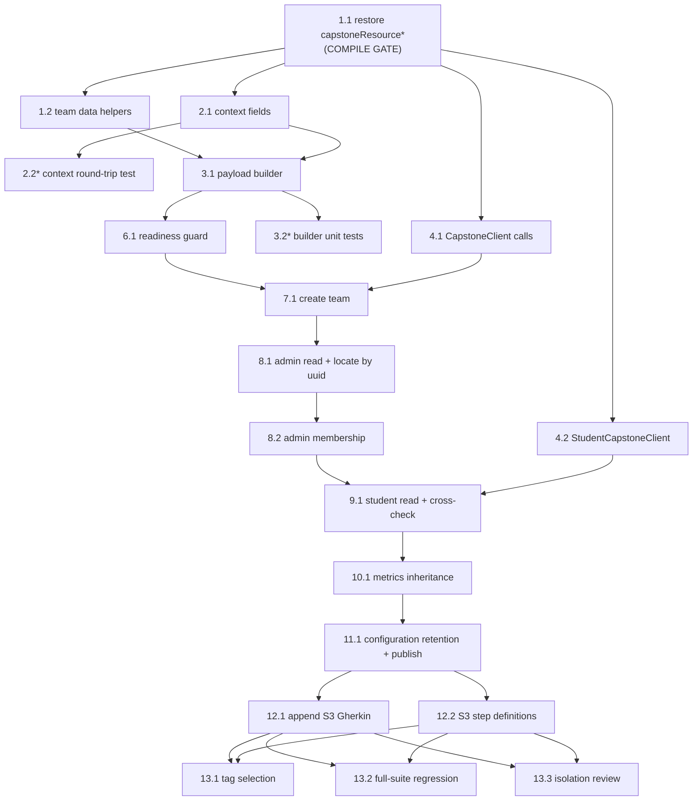

# Implementation Plan: Capstone Team Management (S3)

## Overview

S3 ("Admin creates a Capstone team and verifies the team configuration") is the **third scenario of the
existing Capstone journey**. It consumes the suite-scoped state S1 and S2 produced and creates exactly ONE
new entity — the Capstone team (`sectionGroup`) — through three HTTP calls (1 admin POST, 1 admin GET,
1 student GET) behind seven Gherkin steps.

Implementation language: **Java** (the design specifies Java + RestAssured + Cucumber; no language choice
is open).

The plan is built as vertical slices, each with its own verifiable demo. Two hard facts shape the ordering:

- **The project does not compile today.** `CapstoneWorkflow` and `CapstoneWorkflowPayloadTest` reference
  `TestDataFactory.capstoneResourceFolderName()`, `capstoneResourceName()` and `capstoneResourceLink()`
  across ~13 call sites and `TestDataFactory` declares none of them. Task 1 is a gate: nothing else can be
  built, run or demoed until it lands.
- **ZERO new `.feature` files.** The S3 scenario is appended to
  `src/test/resources/features/10_journeys/Capstone.feature`. See task 12.1.

### Live-run caveat (applies to tasks 6–11 and 13)

The capstone journey consumes suite-scoped runtime state, so any live demo needs a healthy environment and
the prerequisite journeys in the tag filter:

```
mvn -o clean test "-Dcucumber.filter.tags=@environment-setup or @assignment or @capstone or @cleanup"
```

Running `-Dcucumber.filter.tags=@team-management` alone does **not** provision anything — the readiness
guard fails naming the missing state and its producing stage (that is task 6's demo, not a bug).

Tasks 6–11 add workflow methods; the Gherkin scenario and step bindings land in task 12, so each of 6–11
is verified offline (`mvn -o test-compile`, plus its unit-testable parts) and then exercised live once 12.1
and 12.2 exist. If you want incremental live feedback per step, land 12.1 and 12.2 immediately after
task 11.1 compiles and re-run after each subsequent slice.

### Testing approach

The design's Correctness Properties section states explicitly that **property-based testing is NOT
applicable** to S3 (one fixed live-integration scenario, real writes against a shared dev LMS, no input
space to quantify over). No PBT library is introduced. The named invariants are verified by example-based
unit tests over the pure payload builder plus the live scenario's own read-back assertions; tasks below
reference the property they close.

---

## Tasks

- [x] 1. Restore compilation and add Capstone team test data
  - [x] 1.1 Restore the three missing `capstoneResource*` helpers in `src/test/java/com/lms/utils/TestDataFactory.java`
    - Add `capstoneResourceFolderName()`, `capstoneResourceName()` and `capstoneResourceLink()` satisfying the ~13 existing call sites in `CapstoneWorkflow.java` and `CapstoneWorkflowPayloadTest.java`
    - Introduce a single per-JVM `private static final String CAPSTONE_RUN_SUFFIX = uniqueSuffix();` constant and derive the name helpers from it — **not** a fresh `uniqueSuffix()` per call: S2's existing read-back assertions compare the same helper across two separate calls (builder vs read-back), so a per-call suffix would make correct data fail
    - `capstoneResourceLink()` returns a fixed placeholder URL following the existing `assignmentSubmissionDriveLink()` convention — no invented external integration
    - Do **not** modify any existing S2 assertion in `CapstoneWorkflow.java` or `CapstoneWorkflowPayloadTest.java`; the restored helpers must satisfy them as they stand
    - Demo: `mvn -o test-compile` passes and `mvn -o test -Dtest=CapstoneWorkflowPayloadTest` runs the existing 29 tests green
    - _Requirements: 11.1, 11.2, 11.3, 11.4_

  - [x] 1.2 Add the three Capstone team data helpers to `src/test/java/com/lms/utils/TestDataFactory.java`
    - Add `capstoneTeamName()`, `capstoneTeamDescription()` and `capstoneTeamRepresentativeLabel()`, all derived from the same `CAPSTONE_RUN_SUFFIX` so each value is stable within one suite run and a read-back can compare it by equality
    - Document on `capstoneTeamRepresentativeLabel()` that the label is generated rather than composed from the student's name because `ExecutionContext` holds no student first/last name, and that the label is a cosmetic display value — the membership verdict comes from `groupRepresentative.value`
    - Demo: `mvn -o test-compile` passes; all three helpers return non-blank values that are identical across two calls in the same JVM
    - _Requirements: 11.5, 11.6, 11.7, 2.4_

- [x] 2. Add suite-scoped team identity state
  - [x] 2.1 Add `capstoneTeamUuid` / `capstoneTeamName` to the context
    - `src/test/java/com/lms/context/ExecutionContext.java`: declare both fields inside the existing Capstone block with getters/setters matching the existing capstone accessor convention (single-line accessors, as used by `getCapstoneTermCourseId` / `setCapstoneTermCourseId`)
    - `src/test/java/com/lms/context/ScenarioContext.java`: add two delegating getter/setter pairs in its Capstone block, following `getCapstoneTermCourseId()` → `execution().getCapstoneTermCourseId()`
    - Javadoc must state that the value is resolved ONCE at creation from `Data[0].uuid` / `Data[0].name` and never re-derived from a list read, a name search or an array position
    - Add no other context field; `sectionId`, `termCourseId` and `sectionCourseId` keep having no setter call in the S3 code path
    - Demo: `mvn -o test-compile` passes
    - _Requirements: 3.1, 3.2, 3.4, 9.2, 9.3_

  - [ ]* 2.2 Write a unit test round-tripping both new context fields
    - New file `src/test/java/com/lms/context/CapstoneTeamStateTest.java` (or the nearest existing context test, if one exists) setting and reading both fields through `ScenarioContext` and asserting the values arrive on `ExecutionContext`
    - Assert that overwriting an existing value replaces it rather than being ignored (stale-value overwrite rule)
    - Placeholder values only — zero live uuids, zero credentials, zero HTTP
    - Demo: `mvn -o test -Dtest=CapstoneTeamStateTest` green
    - _Requirements: 3.4, 3.6, 14.4_

- [x] 3. Payload builder and its unit coverage
  - [x] 3.1 Add the pure team-creation payload builder to `src/test/java/com/lms/workflows/CapstoneWorkflow.java`
    - Package-private `static Map<String, Object> buildCapstoneTeamPayload(String capstoneSectionId, String capstoneTermCourseId, String adminUserId, String teamName, String teamDescription, String studentUuid, String representativeLabel)` returning nested `LinkedHashMap`s, following the existing `buildResources`-style builder convention
    - Exactly 5 top-level keys in order: `sectionId`, `termCourseId`, `createdBy`, `sectionGroup`, `allowTeamFormation`
    - Exactly 6 `sectionGroup[0]` keys in order: `name`, `description`, `image`, `size`, `userGroup`, `groupRepresentative`
    - Wire types: `size` is the JSON String `"1"`, `image` is the empty String `""`, `allowTeamFormation` is a JSON boolean `false`, `userGroup` is a flat single-element array of the student uuid String, `groupRepresentative` is an object with exactly `value` then `label`
    - Pure function: no HTTP, no context reads, no assertions
    - Demo: `mvn -o test-compile` passes
    - _Requirements: 2.2, 2.3, 2.4, 2.5, 12.1, 14.1_

  - [x]* 3.2 Add the third `====` section to `src/test/java/com/lms/workflows/CapstoneWorkflowPayloadTest.java`
    - Follow the file's existing convention: banner comment block, then tests, then fixtures
    - Pin the exact top-level key set and key **order** (5 keys) and the exact `sectionGroup[0]` key set and key **order** (6 keys)
    - Pin `size` as a String, `image` as the empty String, `allowTeamFormation` as a boolean, `userGroup` as a flat single-element array of Strings, `groupRepresentative` as exactly `{value, label}` with `value` equal to the student uuid
    - Assert the returned map is a `LinkedHashMap` so wire order equals declared order
    - Fixtures use distinguishable placeholders (`capstone-section-placeholder`, `capstone-termcourse-placeholder`, `admin-user-placeholder`, `student-uuid-placeholder`) so a swapped argument fails loudly; zero live uuids, zero credentials, zero HTTP
    - Closes **Property 1: Payload wire contract**
    - Demo: `mvn -o test -Dtest=CapstoneWorkflowPayloadTest` green — new tests alongside the existing 29
    - _Requirements: 14.1, 14.2, 14.3, 14.4, 14.5_

- [x] 4. Add the client calls
  - [x] 4.1 Add the two admin-token calls to `src/test/java/com/lms/clients/admin/CapstoneClient.java`
    - `addStudentsInGroup(Map<String, Object> payload, String bearerToken)` → `POST /api/v1/program/addStudentsInGroup`, serialised with the class's existing null-preserving GSON and passed to `RestClient` as a JSON String so the caller's `LinkedHashMap` key order reaches the wire unchanged
    - `getAllSectionGroups(String termCourseId, String sectionId, String bearerToken)` → `GET /api/v1/program/termCourse/{termCourseId}/section/{sectionId}/getAllSectionGroups` with the HAR-proven pagination trio sent verbatim: `searchParam` empty, `pageSize` 10000, `pageNo` 1
    - Both methods take ids as ordinary String parameters and read no context, so the client cannot address the runtime section by accident
    - Request shaping and serialisation only: zero assertions, zero orchestration, zero business logic; no timeout override, no retry
    - `RestClient.get(String, Map<String, ?>, String)` and `RestClient.post(String, String, String)` already exist and are the intended seams
    - Demo: `mvn -o test-compile` passes; a grep of the two new methods shows no `assertThat` and no context access
    - _Requirements: 12.3, 12.5, 12.6, 4.1, 2.1_

  - [x] 4.2 Create `src/test/java/com/lms/clients/student/StudentCapstoneClient.java`
    - New client in the existing `clients/student` package (alongside `AcademicSummaryClient`, whose shape it follows) because `CapstoneClient` is admin-scoped
    - `getCapstoneGamificationForTerm(String programTermId, String capstoneTermCourseId, String capstoneSectionId, String studentToken)` → `GET /api/v1/program/capstoneGamifications/term/{programTermId}?courseId={capstoneTermCourseId}&sectionId={capstoneSectionId}`, built from `TestConfig.API_V1`
    - Comment that `courseId` is keyed by **TermCourse** uuid, not CourseMaster uuid — the API's parameter name disagrees with the identity it keys off, and passing the CourseMaster uuid is a defect
    - The bearer token is a parameter; the class references no static credential accessor, so `StudentCredentialIsolationTest` stays green
    - Assertion-free, orchestration-free, no retry
    - Demo: `mvn -o test-compile` passes; `mvn -o test -Dtest=StudentCredentialIsolationTest` green
    - _Requirements: 12.4, 12.5, 5.1, 5.2, 5.8_

- [x] 5. Checkpoint — offline build and unit tests green
  - Run `mvn -o clean test-compile` and the offline unit tests (`CapstoneWorkflowPayloadTest`, `StudentCredentialIsolationTest`, the new context test). Ensure all tests pass, ask the user if questions arise.

- [x] 6. Readiness guard
  - [x] 6.1 Add `validateCapstoneReadyForTeamFormation(ScenarioContext context)` to `src/test/java/com/lms/workflows/CapstoneWorkflow.java`
    - Verify the 8 consumed String values are non-blank (`capstoneSectionId`, `capstoneTermCourseId`, `capstoneGamificationConfigUuid`, `programTermId`, `studentUuid`, `studentToken`, `adminUserId`, `adminToken`) and that `capstoneGamificationConfigNumericId` is non-null and greater than zero
    - One aggregated failure message listing **every** missing value, each mapped to its producing stage (Environment Setup / S1 / S2)
    - Runtime-identity collision guard: fail if `capstoneTermCourseId` equals `termCourseId` or `capstoneSectionId` equals `sectionId`, with a message identifying the collision as the capstone identity converging on the runtime identity the Assignment, Session and Attendance journeys depend on
    - Zero HTTP requests, zero writes to `ExecutionContext`, zero writes to the per-scenario attribute map, zero provisioning on failure
    - One `CapstoneJourneyReport.checkpoint(...)` on pass, naming the consumed capstone section, term course, numeric config id, program term and student uuid
    - Demo: `mvn -o test-compile` passes; once task 12 lands, `mvn -o clean test "-Dcucumber.filter.tags=@team-management"` fails on the Given step naming the missing state and its producing stage — and provisions nothing
    - _Requirements: 1.1, 1.2, 1.3, 1.4, 1.5, 1.6, 1.7_

- [x] 7. Create the Capstone team
  - [x] 7.1 Add `createCapstoneTeamWithRuntimeStudent(ScenarioContext context)` to `src/test/java/com/lms/workflows/CapstoneWorkflow.java`
    - One `CapstoneClient.addStudentsInGroup` call with the admin token, built from `buildCapstoneTeamPayload` and the `TestDataFactory` team helpers; zero retries, no scenario-specific timeout
    - Assert status 201, `Data` is an array with exactly one element, `Data[0].uuid` non-blank, `Data[0].name` equals the sent `name`, `Data[0].gamificationConfigId` is a number greater than zero and equals `capstoneGamificationConfigNumericId` **compared as numbers**
    - After the assertions pass, write `capstoneTeamUuid` and `capstoneTeamName` once, overwriting any stale value so a re-run within one suite verifies the new team
    - On any failure leave both fields unset, issue zero retry or compensating request, and register zero cleanup resources
    - Document adjacent to the creation call that the team is **deliberately unregistered** for cleanup: no `ResourceType` value represents a team, inventing a cleanup path is out of scope, `DELETE .../deleteSectionGroup` stays unused, and teardown is left to the platform's section-scoped lifecycle (an unverified, documented gap)
    - A 2xx alone records no checkpoint — the persistence verdict is deferred to task 8's fresh read
    - Closes **Property 4: Configuration binding** (create-response half)
    - Demo: live run reaches the When step, creates one team, and the log/report shows the captured uuid and name
    - _Requirements: 2.1, 2.6, 2.7, 2.8, 2.9, 2.10, 2.11, 3.1, 3.6, 10.1, 10.3, 10.4, 10.5_

- [x] 8. Admin-side verification
  - [x] 8.1 Add `verifyCapstoneTeamCreated(ScenarioContext context)` to `src/test/java/com/lms/workflows/CapstoneWorkflow.java`
    - One fresh `CapstoneClient.getAllSectionGroups(capstoneTermCourseId, capstoneSectionId, adminToken)` read; assert status 200 **before** reading any body field
    - Add private `findTeamByUuid(Response, String)` locating the entry in `Data` by `uuid` equality only — never by `name`, array position or `Count` — mirroring the existing `findSectionCourseByCourseMaster` discipline
    - Assert the located team's `name` equals `capstoneTeamName`, `groupSize` equals 1 and `status` equals `accepted`
    - Cache the response under an S3-owned attribute key (`S3_ADMIN_TEAM_READ`) so tasks 8.2, 10 and 11 assert over the same evidence; if the attribute is absent, the consumer issues the read itself
    - Failure messages: when no entry matches, list **every** team uuid returned alongside the expected uuid; when `capstoneTeamUuid` is blank, name the creation step that produces it
    - One checkpoint after the assertions pass
    - Closes **Property 2: Team identity stability** (admin half)
    - Demo: live run — the Then step passes off a separate read, and temporarily pointing the lookup at a wrong uuid produces the full returned-uuid list in the failure message
    - _Requirements: 4.1, 4.2, 4.3, 4.4, 3.3, 3.5, 8.1, 8.3_

  - [x] 8.2 Add `verifyAdminSeesRuntimeStudentInTeam(ScenarioContext context)` to `src/test/java/com/lms/workflows/CapstoneWorkflow.java`
    - Zero HTTP: assert over the cached admin read from 8.1
    - Add private `memberEntriesFor(Map<String,Object> team, String studentUuid)` and assert exactly one `UserGroups[]` entry carries `User.uuid` equal to the runtime student uuid, compared by exact case-sensitive String equality with no trimming
    - Assert that entry is marked `isGroupRepresentative`
    - Treat `Count` as the number of teams in the capstone section, never as a membership count; derive membership from `Data[i].UserGroups`
    - On a member count other than 1, report the observed count and **every** member uuid returned
    - One checkpoint naming the verified team uuid and member uuid
    - Closes **Property 3: Cross-actor membership agreement** (admin half)
    - Demo: live run — admin-side membership proven from the read, with zero additional HTTP calls in the step
    - _Requirements: 4.5, 4.6, 4.7, 4.8_

- [x] 9. Student-side verification and same-team cross-check
  - [x] 9.1 Add `verifyStudentSeesCapstoneTeamMembership(ScenarioContext context)` to `src/test/java/com/lms/workflows/CapstoneWorkflow.java`
    - One `StudentCapstoneClient.getCapstoneGamificationForTerm(programTermId, capstoneTermCourseId, capstoneSectionId, studentToken)` call using the **student** token; assert status 200 and read **zero** body fields on any other status, reporting the requested `programTermId`, `courseId` and `sectionId`
    - Assert `Data.cousreData.uuid` equals `capstoneTermCourseId`, `Data.cousreData.isGamify` is boolean `true` and `Data.cousreData.Section.uuid` equals `capstoneSectionId` — addressing the API's own misspelling `cousreData` verbatim, with zero correction
    - Same-team cross-check: assert `Data.userGroup.uuid` equals `capstoneTeamUuid`; on a mismatch report both uuids and perform **zero** membership assertions against the observed team. Fail with a dedicated message when `Data.userGroup` is absent, null or an empty object
    - Assert `Data.userGroup.name` equals `capstoneTeamName` and `status` equals the exact lowercase `accepted`; assert exactly one `Data.userGroup.UserGroups` entry whose `User.uuid` equals the runtime student uuid, reporting the observed count and every member uuid on failure
    - Treat `doubtDiscussion.groupMember` as evidence only — zero pass/fail verdict derived from it
    - Leave `adminToken` and `adminUserId` unchanged; cache the response under `S3_STUDENT_CAPSTONE_READ`; log/report no token, password or `Authorization` value
    - One checkpoint naming the verified team uuid and member uuid
    - Closes **Property 2** (student half) and **Property 3** (student half)
    - Demo: live run — the step passes against a genuine student session, and the student-visible team uuid equals the admin-created one
    - _Requirements: 5.1, 5.2, 5.3, 5.4, 5.5, 5.6, 5.7, 5.8, 5.9, 5.10, 5.11_

- [x] 10. Metrics inheritance
  - [x] 10.1 Add `verifyCapstoneTeamInheritsMetrics(ScenarioContext context)` and `assertMetricSetsEqual(...)` to `src/test/java/com/lms/workflows/CapstoneWorkflow.java`
    - Zero HTTP: compare the cached admin read's team `metrics` against the cached student read's `GamificationConfig.metrics`
    - Order-independent set comparison keyed by the `metric` name field: assert cardinality 6 on both sides and equal name sets; pair by name only, never by array position, so an ordering-only difference passes
    - For each shared name assert `target`, `type`, `showDashboard` and `currency` equal with their **original JSON types preserved**; compare an empty-String `target` by value as the configured value
    - Fail once after evaluating everything: list every name present in one collection only and, per shared name, every field whose value or JSON type differs with both observed values
    - If a required authoritative read is unavailable, fail naming which read is missing; substitute zero S2-cached value
    - One checkpoint naming the number of inherited metrics
    - Closes **Property 5: Metric inheritance**
    - Demo: live run green; a deliberately reordered fixture of the two metric lists still passes while a single changed `target` fails with both observed values named
    - _Requirements: 6.1, 6.2, 6.3, 6.4, 6.5, 6.6, 6.7, 7.10, 8.2_

- [x] 11. Configuration retention and report publication
  - [x] 11.1 Add `verifyCapstoneTeamRetainsConfiguration(ScenarioContext context)` and `assertRetainedConfiguration(...)` to `src/test/java/com/lms/workflows/CapstoneWorkflow.java`
    - Compare exactly the 9 pairs and nothing else: `gamificationConfigId` ↔ `GamificationConfig.id` (as **numbers**), `metrics` (order-independent set, per task 10), `leaderboard`, `xByXRows`, `xByXColumns`, `resources`, `scheduleStartDate`, `scheduleEndDate`, `allowTeamFormation`
    - `leaderboard` is JSON-type-strict: numeric `40` must not satisfy the String `"40"`, and a type difference is a mismatch even when the textual values match
    - `scheduleStartDate` / `scheduleEndDate` compare as exact Strings with zero date, format or timezone normalization; `resources`, `xByXRows` and `xByXColumns` compare index-wise
    - Exclude exactly the 6 `Configuration_Exclusion_List` fields — `leaderboardType`, `triggerInterval`, `triggerDay`, `allowSkipUntil`, `analyticsDisplay`, `dashboardDisplay` — each carrying its HAR-observed rationale in a comment adjacent to the exclusion; the step passes when these differ or are absent
    - Batch reporting: evaluate every remaining pair, then fail once listing per mismatch the field name, the team-visible value with its JSON type and the configuration value with its JSON type; distinguish an **absent** field from a field **present with null**, naming which object omitted it
    - Use `capstoneGamificationConfigNumericId` wherever a numeric configuration identifier is required and `capstoneGamificationConfigUuid` only where the API exposes the uuid
    - One checkpoint naming the compared field groups and the count of excluded fields, then `CapstoneJourneyReport.publish(context)` exactly once at the end of this final step
    - Closes **Property 6: Configuration retention closure** and **Property 4** (read-back half)
    - Demo: live run — the full S3 scenario green with the capstone journey report published once
    - _Requirements: 7.1, 7.2, 7.3, 7.4, 7.5, 7.6, 7.7, 7.8, 7.9, 7.10, 13.6, 13.7_

- [x] 12. Append the S3 scenario and wire the step definitions
  - [x] 12.1 Append the S3 comment block and scenario to `src/test/resources/features/10_journeys/Capstone.feature`
    - **ZERO new `.feature` files.** Creating, renaming, splitting or duplicating any Capstone Gherkin file — `CapstoneTeamManagement.feature`, `capstone-team-management.feature`, `Team.feature`, `CapstoneTeam.feature` or any other — **is a defect, not an alternative**. The `.kiro/specs/capstone-team-management/` folder name is an organizational container for these documents only and must not produce a matching feature file
    - Edits are **additive and at the end of the file only**. Preserved byte-for-byte: the `Feature: Capstone Mini-Setup` name and its four `As a / I want / So that` lines; the `# BUSINESS JOURNEY` / `# FOUR DISTINCT ENTITIES` / `# ISOLATION` / `# THE COMPLETE JOURNEY` comment block; the S1 scenario with its title, tags (`@journey @capstone @requires-credentials`) and steps; the S2 introductory comment block, scenario, title, tags (`@journey @capstone @configuration @requires-credentials`) and steps; and the S1 → S2 ordering
    - Add one S3 comment block following the exact convention the file already uses to introduce S2, stating that S3 consumes the suite-scoped state S1 and S2 produced and creates only the team
    - Add the scenario titled `Admin creates a Capstone team and verifies the team configuration` tagged `@journey @capstone @team-management @requires-credentials`, with the seven agreed steps in the design's exact wording (readiness precondition, team creation, creation verification, admin-side membership, student-side membership, metrics inheritance, configuration retention)
    - Demo: `git diff` on the feature file shows additions only, zero modified or deleted existing lines, and `git status` shows no new `.feature` file
    - _Requirements: 13.1, 13.2, 13.3, 13.8, 9.5_

  - [x] 12.2 Add the seven thin step methods to `src/test/java/com/lms/steps/workflows/CapstoneSteps.java`
    - Under a new `S3` banner comment, following the file's existing banner convention; existing S1/S2 methods untouched and the existing constructor reused as-is
    - Each method is a single delegation to its `CapstoneWorkflow` method: zero HTTP, zero payload construction, zero assertions
    - Demo: `mvn -o clean test "-Dcucumber.filter.tags=@environment-setup or @assignment or @capstone or @cleanup"` green with S3 executing all seven steps and zero undefined steps reported
    - _Requirements: 12.1, 12.2, 12.7, 12.8_

- [x] 13. Final checkpoint — tag selection, regression and isolation review
  - [x] 13.1 Verify tag selection
    - `mvn -o clean test "-Dcucumber.filter.tags=@capstone"` selects S1 + S2 + S3; `-Dcucumber.filter.tags=@team-management` selects S3 alone; `-Dcucumber.filter.tags=@configuration` still selects S2 alone
    - Demo: the Cucumber run summary shows the expected scenario counts for each selector
    - _Requirements: 13.4, 13.5_

  - [x] 13.2 Verify runtime environment isolation by full-suite regression
    - Run the full suite with S3 present and confirm the Assignment, Session and Attendance journeys produce the same outcomes as a run without it
    - Confirm the S3 code path issues zero creation requests for Program, Cohort, Program Term, Section, CourseMaster, TermCourse or Student, and that exactly one new entity is created per run
    - Demo: full-suite results comparison plus a grep showing no `setSectionId` / `setTermCourseId` / `setSectionCourseId` call in the S3 code path
    - _Requirements: 9.1, 9.2, 9.3, 9.4, 9.8_

  - [x] 13.3 Review untouched-component and no-literals guarantees
    - Confirm `CleanupManager`, `ResourceType`, `RestClient`, `Hooks`, `TestConfig`, `EnvironmentConfig` and `CapstoneJourneyReport` are unchanged, that `ResourceType` retains its existing value set, and that zero cleanup resources are registered for the team
    - Confirm the Assignment, Session and Attendance feature files, step classes, workflows and clients are unchanged, and that S1/S2 scenarios, steps and workflow methods are unchanged
    - Confirm the S3 implementation contains zero literal uuids, numeric entity ids, email addresses or dates, and that every compared date comes from an authoritative read
    - Closes **Property 7: Environment isolation**
    - Demo: `git diff --stat` shows only the 8 files the design lists as touched, and a grep for uuid/email/date literals in the S3 code path returns nothing
    - _Requirements: 8.4, 8.5, 9.5, 9.6, 9.7, 10.1, 10.2, 10.3, 10.4_

## Notes

- Tasks marked with `*` are optional (offline unit tests) and can be skipped for a faster path to the live
  scenario; everything else is core.
- Task 1 is a hard gate: the module does not compile until 1.1 lands, so no other task can be built or run.
- Task 7.1 gates 8–11: without a created team there is no uuid to verify against.
- Tasks 6–11 all modify `CapstoneWorkflow.java`, so they are strictly sequential to avoid write conflicts.
- No property-based testing library is introduced; the design's named invariants are closed by the unit
  tests in 2.2 / 3.2 and the live assertions in 6–11, as noted per task.
- Live runs need the prerequisite journeys in the tag filter — see the live-run caveat above.

## Task Dependency Graph



```json
{
  "waves": [
    { "id": 0, "tasks": ["1.1"] },
    { "id": 1, "tasks": ["1.2", "2.1", "4.1", "4.2"] },
    { "id": 2, "tasks": ["2.2", "3.1"] },
    { "id": 3, "tasks": ["3.2", "6.1"] },
    { "id": 4, "tasks": ["7.1"] },
    { "id": 5, "tasks": ["8.1"] },
    { "id": 6, "tasks": ["8.2"] },
    { "id": 7, "tasks": ["9.1"] },
    { "id": 8, "tasks": ["10.1"] },
    { "id": 9, "tasks": ["11.1"] },
    { "id": 10, "tasks": ["12.1", "12.2"] },
    { "id": 11, "tasks": ["13.1", "13.2", "13.3"] }
  ]
}
```
